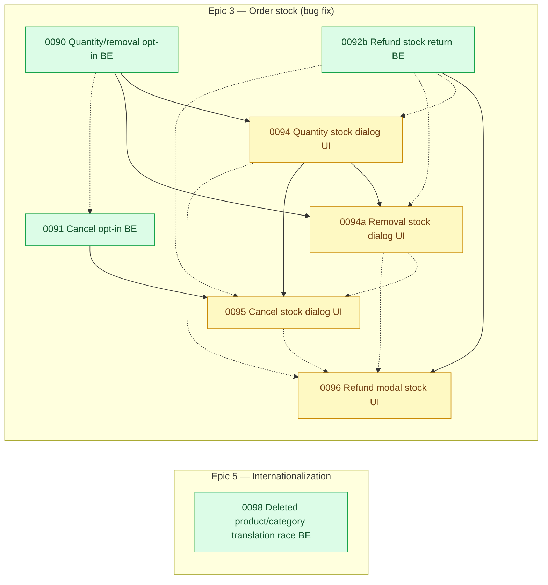

# Task Map — `ai-spec/tasks/` Inventory and Dependency Graph

**This file maps parallelization risk for pending work only.** `done/` tasks are intentionally
left out of the dependency graph below — a merged, closed task can only ever be a *satisfied*
dependency for something still pending, never a source of conflict for work still being
implemented, so drawing it as a node would only add clutter with no decision value.

Aggregated view of every task file under `ai-spec/tasks/` (the three-stage `ai-spec/tasks/` →
`ai-spec/tasks/in-progress/` → `ai-spec/tasks/done/` convention documented in
[`docs/workflow.md`](../docs/workflow.md)). **This file was originally a point-in-time,
manually-regenerated snapshot; it no longer is.** Per
[`docs/workflow.md`'s task-coordination-file regeneration step](../docs/workflow/task-files-links-and-ordering.md#regenerating-the-task-coordination-files),
`docs-keeper` now updates the affected part of this file on the same pass as the mandatory
link-integrity check, every time a task file is created, moves to `in-progress/`/`done/`, or has
its own "Dependencies" section edited — so it should reflect the real backlog rather than
needing a manual "is this stale" check. `docs/workflow.md`'s per-story `ai-spec/tasks/` files
remain the source of truth for any individual story's dependencies; this file only aggregates
and cross-references what those files already state — if the two ever disagree, the individual
task file is correct and this one needs a refresh.

**Update (2026-11-13): `0087-translation-write-actions-refuse-inactive-store-language.md` completed Phase 7 and moved from `ai-spec/tasks/in-progress/` to `ai-spec/tasks/done/`** (claimed by `worktree-0087-translation-write-actions-refuse-inactive-language`; Phases 3–6 approved, full unscoped suite green: 6162 tests). Its node, inventory row, `claimed` class membership and the edge `P0087 --> P0098` are dropped; it joins the flat `done/` inventory (Epic 5: 17; `done/` holds 116 files) and its `tasks-status.json` entry is deleted. Dependents recomputed: `0098` had `0087` as its only pending dependency, so `depends_on` is now empty and it moves `blocked` -> `ready` (green); it drops `0087` from `conflict_risk_with` (now empty). No node is `claimed`; `ai-spec/tasks/in-progress/` is empty again. Link check, both directions: same-depth move, so the moved file's `](../done/…)` links became bare siblings and its `../../../docs/…` and `../0098-…` links needed no change; all resolve. Inbound links were repointed and resolve: bare sibling `](0087-…)` in `done/0075` (1), `done/0076a` (2), `done/0076b` (2), `done/0077` (2), `done/0078` (1); `](done/0087-…)` in `0098` (2); `../../ai-spec/tasks/done/0087-…` in `docs/api/blog.md` lines 49 and 120. The Epic 5 digest has no link to the file. No broken link remains.

**Update (2026-11-13, superseded by the closure above): `0087` Phase 2 APPROVED, new pending task `0098`, and `0087` moved from `ai-spec/tasks/` to `ai-spec/tasks/in-progress/`** (claimed by `worktree-0087-translation-write-actions-refuse-inactive-language`, Phase 3 step 0). `code-reviewer` approved `0087` on the re-review with six non-blocking findings, folded into the file; the user closed its Q-3 (a) (post-level callout wording) and Q-4 (a) (0076b residual L-2 out of scope) and asked for a separate task for L-2: **`0098-translation-write-actions-deleted-entity-race-backend.md`** (backend, Phase 1 draft by `product-owner`, Q-1–Q-3 open for the user). `0098` edits the same action and test files as `0087` (`SetProductTranslation`, `SetProductCategoryTranslation` and their tests) and builds on its order, so it gets the hard edge `P0087 --> P0098` (`depends_on: ["0087"]`, yellow `pending`, status `blocked`) and `conflict_risk_with` both ways. `P0087` moves from green `ready` to blue `claimed`. The Epic 5 digest's L-2 line now points to `0098`. Link check, both directions: the moved file's outbound links were repointed one level deeper (`](done/…)` to `](../done/…)`, `](../../docs/…)` to `](../../../docs/…)`, `](0098-…)` to `](../0098-…)`) and all resolve; inbound links were repointed from `](../0087-…)` to `](../in-progress/0087-…)` in `done/0075` (1), `done/0076a` (2), `done/0076b` (2), `done/0077` (2), `done/0078` (1) and resolve; `0098` links to `in-progress/0087-…`. **One inbound link is still stale and is `docs-keeper`'s to fix** (outside `product-owner`'s write scope): `docs/api/blog.md` line 49 must become `../../ai-spec/tasks/in-progress/0087-translation-write-actions-refuse-inactive-store-language.md`. `ai-spec/tasks/in-progress/` holds exactly `0087`.

**Update (2026-11-13, Phase 2 rejection of `0087`, superseded by the update above): `0087` rewritten in place by `product-owner`; still pending Phase 2 re-review.** Scope widened to all five `Set*Translation` actions through a new shared `App\Actions\Translations\ResolveActiveStoreLanguage`, plus the blog post editor's danger callout for `SetBlogPostTranslation`'s post-level refusal (user decisions Q-1 and Q-2 (a)). Dependencies unchanged (`depends_on: []`, every related story is in `done/`), so the node stays green `ready` and no edge changes; only its `tasks-status.json` `touches` widened (helper and its test, `SetBlogTagTranslation`, `SetProductTranslation`, `SetBlogPostTranslation`, `BlogPosts\Editor` and its view, `lang/{en,es}/blog-posts.php`, `SetBlogPostTranslationTest`, `BlogPostEditorTranslationValidationTest`). No other pending task touches those files, so `conflict_risk_with` stays empty. No file moved; every relative link in `0087` resolves.

**Update (2026-11-12): `0079-blog-post-editor-language-tabs-ui.md` completed Phase 7 and moved from `ai-spec/tasks/in-progress/` to `ai-spec/tasks/done/`** (claimed by `worktree-0079-blog-post-editor-language-tabs-ui`; full unscoped suite green in 36 chunks, Phase 5 approved). It is the last Epic 5 story. Its node, inventory row, `claimed` class membership and the dashed edge `P0087 -.-> P0079` are dropped; it joins the flat `done/` inventory (Epic 5: 16; `done/` holds 114 files) and its `tasks-status.json` entry is deleted. No pending task depended on it; `0087` drops `0079` from `conflict_risk_with` and stays `ready`. No node is `claimed`; `ai-spec/tasks/in-progress/` is empty again. Link check, both directions: same-depth move, so the moved file's 46 outbound links were re-resolved and all resolve; inbound links were repointed in `0087` (`](done/0079-…)`) and in `done/0021`, `done/0063`, `done/0077`, `done/0078` (bare sibling `](0079-…)`), 22 in all, and resolve. The last inbound link, in `docs/api/products/routeless-components.md`, now points to `../../../ai-spec/tasks/done/0079-blog-post-editor-language-tabs-ui.md`.

**Update (2026-11-12, superseded by the closure above): `0079-blog-post-editor-language-tabs-ui.md` moved from `ai-spec/tasks/` to `ai-spec/tasks/in-progress/`** (Phase 2 approved on the third `code-reviewer` review, Q-1/Q-2 closed by the user, then Phase 3 step 0; claimed by `worktree-0079-blog-post-editor-language-tabs-ui`). Still pending work, so it keeps its node and the dashed pairing `P0087 -.-> P0079`; the node moves from the green `ready` class to the blue `claimed` class and its `tasks-status.json` entry becomes `"claimed"` (`depends_on` still empty, `touches` widened to the story's *Files to create/modify* set, which uses `lang/{en,es}/blog-posts.php`, not `blog.php`). `ai-spec/tasks/in-progress/` holds exactly this one file. Link check, both directions: the moved file's 46 outbound links were repointed one level deeper and all resolve; 22 inbound links under `ai-spec/` were repointed (`0087`: `](in-progress/0079-…)`; `done/0021`, `done/0063`, `done/0077`, `done/0078`: `](../in-progress/0079-…)`) and all resolve. **One inbound link is still stale and is `docs-keeper`'s to fix** (outside `product-owner`'s write scope): `docs/api/products/routeless-components.md` line 43 must become `../../../ai-spec/tasks/in-progress/0079-blog-post-editor-language-tabs-ui.md`.

**Update (2026-11-12): `0092a-record-refund-lock-order-backend.md` completed Phase 7 and moved from `ai-spec/tasks/in-progress/` to `ai-spec/tasks/done/`** (claimed by `worktree-0092a-record-refund-lock-order-backend`; Phase 4 security audit and Phase 5 code review approved, full suite green, PR pending). Its node, inventory row, `claimed` class membership and edge `P0092a --> P0092b` are dropped; it joins the flat `done/` inventory (Epic 3 recounted as 22) and its `tasks-status.json` entry is deleted. Dependents recomputed: `0092b` had `0092a` as its only pending dependency, so `depends_on` is now empty and it moves `blocked` -> `ready` (green). No node is `claimed` now; `ai-spec/tasks/in-progress/` no longer holds files. Link check, both directions: same-depth move, outbound links re-verified; inbound links repointed from `in-progress/0092a-…` to `done/0092a-…` in `0092b` and to the bare sibling in `done/0088` and `done/0088a`; a repo-wide grep finds no stale path.

**Update (2026-11-12, superseded by the closure above): `0092a-record-refund-lock-order-backend.md` moved from `ai-spec/tasks/` to `ai-spec/tasks/in-progress/`** (Phase 2 INVEST review APPROVED by `code-reviewer`, then Phase 3 step 0; claimed by `worktree-0092a-record-refund-lock-order-backend`). Still pending work, so it keeps its node and edge (`P0092a --> P0092b`); the node moves from the green `ready` class to the blue `claimed` class and its `tasks-status.json` entry is `"claimed"`. Link check, both directions: the moved file's outbound links gained one `../` level (`../../docs/…` to `../../../docs/…`, `0092b` sibling to `../0092b-…`) and resolve; inbound links from `0092b` and `done/0088`, `done/0088a` were repointed to `in-progress/0092a-…`; a repo-wide grep finds no stale path.

**Update (2026-11-12, merge of `origin/main`): `0097-fix-administrator-user-create-lost-after-step-up.md` and `0088a` are in `done/` (closed on main, 0097 via PR #80); neither is a node, and `0090`/`0091` are `ready`.** The `done/` total, recounted from the directory after merging with the 0077 closure, is 113 (Epic 3: 21, Epic 5: 15, Standalone: 8).

**Update (2026-11-12, backmerge of `origin/main` into the 0079 branch): the 0079 and 0092a closures are both in `done/`.** Recounted from the directory after the merge, `done/` holds 115 files (Epic 3: 22, Epic 5: 16). The `ready` nodes are `0087`, `0090`, `0091` and `0092b`; no node is `claimed` and `ai-spec/tasks/in-progress/` is empty.

**Update (2026-11-10): `0077-product-editor-language-tabs-ui.md` completed Phase 7 and moved from `ai-spec/tasks/in-progress/` to `ai-spec/tasks/done/`** (claimed by `worktree-0077-editor-language-tabs-ui`; PR pending). Its node, inventory row, `claimed` class membership and edges `P0077 -.-> P0079` and `P0087 -.-> P0077` are dropped; it joins the flat `done/` inventory (Epic 5 recounted as 15; `done/` holds 110 files) and its `tasks-status.json` entry is deleted. No dependent changes status (`0079` and `0087` only had it as a soft, dashed pairing and stay `ready`); both drop `0077` from `conflict_risk_with`. No node is `claimed`. Link check, both directions: the moved file's outbound links (`../done/…` became bare siblings) resolve; inbound links from `0079`, `0087`, `done/0021`, `0027`, `0071`, `0076`, `0076a`, `0076b` and `docs/api/products/routeless-components.md` were repointed to `done/0077-…`; a repo-wide grep finds no stale `in-progress/0077` path.

**Update (2026-11-10): `0077-product-editor-language-tabs-ui.md` moved from `ai-spec/tasks/` to `ai-spec/tasks/in-progress/`** (Phase 3 step 0, claimed by `worktree-0077-editor-language-tabs-ui`). Still pending work, so it keeps its node and edge (`P0077 -.-> P0079`); the node moves from the green `ready` class to the blue `claimed` class and its `tasks-status.json` entry is `"claimed"`. Link check, both directions: the moved file's outbound links gained one `../` level (`done/…`, `0079`/`0087` siblings, `../../docs/…`) and all resolve; inbound links from `0079`, `0087` and `done/0021`, `0027`, `0071`, `0076`, `0076a`, `0076b` were repointed to `in-progress/0077-…`; a repo-wide grep finds no stale `0077` path.

**Update (2026-11-10): `0088a-order-stock-auto-deduct-on-create-and-add-backend.md` completed Phase 7 and moved from `ai-spec/tasks/in-progress/` to `ai-spec/tasks/done/`** (claimed by `worktree-0088a-order-stock-auto-deduct`; Phase 4 re-audit and Phase 5 code review approved, full suite green). Its node, inventory row, `claimed` class membership and edges (`P0088a --> P0090/P0091/P0092b`) are dropped; it joins the flat `done/` inventory (Epic 3, order-stock series) and its `tasks-status.json` entry is deleted. Dependents recomputed: `0090` and `0091` had `0088a` as their only pending dependency, so they move `blocked` -> `ready` (green); `0092b` drops `0088a` but stays `blocked` on `0092a`. `ai-spec/tasks/in-progress/` is empty again. The per-epic done counts were not recounted in this pass. Link check: same-depth move, outbound links re-verified; inbound links repointed from `in-progress/0088a-…` to `done/0088a-…` in `0090`, `0091`, `0092b` and `done/0088`; all resolve.

**Update (2026-11-10): `0088-order-stock-adjustment-foundation-backend.md` completed Phase 7 and moved from `ai-spec/tasks/in-progress/` to `ai-spec/tasks/done/`** (claimed by `worktree-0088-order-stock-adjustment-foundation-backend`; Phase 4 security audit and Phase 5 code review approved, full suite green). Its node, its inventory row, its `claimed` class membership and both edges touching it (`P0088 --> P0088a`, `P0088 -.-> P0092a`) are dropped from the graph; it joins the flat `done/` inventory (Epic 3, order-stock series) and its `tasks-status.json` entry (the `claimed` one) is deleted. Dependents recomputed: `0088a` had `0088` as its only pending dependency, so `depends_on` is now empty and it moves `blocked` -> `ready` (green); `0090`, `0091` and `0092b` drop `0088` from `depends_on` and stay `blocked` on `0088a`; `0092a` drops `0088` from `conflict_risk_with`. `ai-spec/tasks/in-progress/` is empty again. The per-epic done counts below were not recounted in this pass. Link check: same-depth move (`in-progress/` -> `done/`), so the moved file's outbound links were re-verified only and all resolve; inbound links were repointed from `in-progress/0088-…` to `done/0088-…` in `0088a`, `0090`, `0091` and `0092b`; all resolve, fragment included.

**Update (2026-11-10): `0076b-product-translation-write-action-backend.md` completed Phase 7 and moved from `ai-spec/tasks/in-progress/` to `ai-spec/tasks/done/`** (claimed by `worktree-0076b-product-translation-write-action-backend`; PR pending). Its node, inventory row, `claimed` class membership and the edges `P0076b --> P0077` and `P0076b -.-> P0087` are dropped; it joins the flat `done/` inventory (Epic 5 recounted as 14; `done/` holds 109 files) and its `tasks-status.json` entry is deleted. `0077` had `0076b` as its only pending dependency, so `depends_on` is now empty and it moves `blocked` -> `ready` (green); `0087` drops `0076b` from `conflict_risk_with`. No node is `claimed`; `in-progress/` is empty. Link check, both directions: outbound links in the moved file resolve (its `](../done/…)` links became bare siblings); inbound links from `0077`, `0079` and `0087` were repointed `in-progress/` -> `done/`; a repo-wide grep finds no stale `in-progress/0076b` path.

**Update (2026-11-10): `0076b-product-translation-write-action-backend.md` moved from `ai-spec/tasks/` to `ai-spec/tasks/in-progress/`** (Phase 3 step 0, claimed by `worktree-0076b-product-translation-write-action-backend`). Still pending work, so it keeps its node and edges (`P0076b --> P0077`, `P0076b -.-> P0087`); the node is now the blue `claimed` class and its `tasks-status.json` entry is `"claimed"`. Inbound links from `0077`, `0079` and `0087` were repointed to `in-progress/`.

**Update (2026-11-10): `0093-confirm-dialog-secondary-action-ui.md` completed Phase 7 and moved from `ai-spec/tasks/in-progress/` to `ai-spec/tasks/done/`** (claimed by `worktree-0093-confirm-dialog-secondary-action-ui`). Its node, its inventory row, its `claimed` class membership and the edges touching it (`P0093 --> P0094`, `P0093 --> P0094a`, `P0093 --> P0095`) are dropped from the graph; it joins the flat `done/` inventory (Epic 3 +1) and its `tasks-status.json` entry is deleted. Dependents recomputed: `0094` (still `blocked` on `0090`), `0094a` (on `0090` and `0094`) and `0095` (on `0091` and `0094`) drop `0093` from `depends_on`; no `status` changes, and no node is `claimed` now. Link check: same-depth move, so the moved file's outbound links were re-verified only; inbound links from `0094`, `0094a` and `0095` were repointed from `in-progress/0093-…` to `done/0093-…`; all resolve.

**Update (2026-11-10): `0093-confirm-dialog-secondary-action-ui.md` moved from `ai-spec/tasks/` to `ai-spec/tasks/in-progress/`** (claimed by `worktree-0093-confirm-dialog-secondary-action-ui`; Phase 3). Still pending work: node and registry entry kept, `claimed`. Link check, both directions: the file's own outbound links gained a `../` segment; the inbound links from `0094`, `0094a` and `0095` now point at `in-progress/`; every relative link resolves.

**Update (2026-11-10, Phase 2 rejection of `0077`): `0077` split; new pending file `0076b-product-translation-write-action-backend.md`.** Project owner decision A: `0077` is now UI only; the `SetProductTranslation` action and the widened `TranslateProductUniqueViolation` moved to `0076b` (numbered below its consumer, `0076a` precedent). Both are pending Phase 2 re-review, none approved. New node `P0076b` (green `ready`, no pending dependency); edge `P0076b --> P0077`, so `0077` turns `blocked` (yellow `pending`, `depends_on: ["0076b"]`); dashed conflict edge `P0076b -.-> P0087` (both edit `lang/{en,es}/products.php`; `0087` lists it back). `0077`'s `touches` now include its seven Feature and two Browser test files. `0087`'s inactive-language amendment note now targets `0076b` and requires its structural guard to cover `SetProductTranslation`; `0079`'s cites of the named-parameters rule and the parallel-arrays decision were repointed to `0076b` D-1 / `0077` D-2. The `ready` set gains `0076b` and loses `0077`. Link check: every relative link in `0076b`, `0077` and the edited `0079`/`0087` lines resolves; no file moved.

**Update (2026-11-08, Phase 2 re-review #4): `0088` split; new pending file `0088a-order-stock-auto-deduct-on-create-and-add-backend.md`.** User decision (0088 OQ-5, option (a)): `0088` keeps the counters only (migration, helpers, counter maintenance in `CreateOrder`/`AddOrderItem` — new lines written stock-neutral —, `RecordRefund` and `UpdateOrderItemQuantity`; no stock movement, safe to ship alone), and the new `0088a` (suffix per the `0076a` precedent) adds `AdjustOrderStock` and the automatic deduction. Dependencies re-derived from the files: `0088a` → `0088`; `0090`, `0091` → `0088a` (and `0088`); `0092b` → `0088a` (and `0088`), `0092a`. Graph: new node `P0088a` (yellow `pending`); the edges `P0088 --> P0090/P0091/P0092b` are replaced by `P0088 --> P0088a --> P0090/P0091/P0092b` (the direct `0088` dependency in those files is transitive). Registry: `0088a` entry added (`blocked`), `0088.touches` narrowed (no `AdjustOrderStock`, no stock tests) and `0088.title` updated; `0088` ↔ `0092a` `conflict_risk_with` kept (both edit `RecordRefund.php`). Inventory: 15 numbered pending. Also: 0088 OQ-4 (virtual products) and 0090 OQ-5 (stock adjustment on a cancelled order) are now user-confirmed. Link check: every relative link and anchor in the eleven series files resolves; the new file's inbound links (0088, 0090, 0091, 0092a, 0092b) resolve.

**Update (2026-11-08, Phase 2 re-review #3): order-stock series rewritten in place.** The reviewer's ledger simulation showed the counter `stock_undeducted_quantity` must hold only non-refunded units; every refund now moves the units it takes from the undeducted ones into the second counter, renamed `stock_refunded_not_out_quantity` (formerly `stock_refund_returned_quantity`, mentioned in the note below). Because refunds without restock and quantity changes without stock adjustment already exist, `0088` now also maintains both counters in `RecordRefund` and `UpdateOrderItemQuantity` (no stock movement). Registry: `0088.touches` gains `app/Actions/Orders/RecordRefund.php`, `app/Actions/Orders/UpdateOrderItemQuantity.php` and `tests/Feature/Orders/OrderStockCountersTest.php`; a new symmetric `conflict_risk_with` pair **`0088` ↔ `0092a`** (both edit `RecordRefund.php`, no dependency between them); `0088` → `0090`/`0092b` already sequence the other shared files. A new dashed edge `P0088 -.-> P0092a` is drawn. No file was created, moved, renamed or deleted; dependencies and statuses unchanged. **Open (user decision pending):** 0088's OQ-5 recommends splitting it into `0088` (counters only, new lines stock-neutral) and `0088a` (deduction); if accepted, `0090`, `0091` and `0092b` would depend on `0088a`. Link check: every relative link and anchor in the ten series files resolves (0088's counter-model heading changed again; its inbound anchor from 0090 was updated).

**Update (2026-11-08, Phase 2 re-review): order-stock series rewritten in place, no structural change.** The user replaced the single stock counter with **two counters** (`order_items.stock_undeducted_quantity` and `order_items.stock_refund_returned_quantity`, 0088 D8 revised, user-confirmed 2026-11-08); `0088`, `0090`, `0091`, `0092b`, `0094a` and `0096` were aligned to it, and `0092a`, `0093`, `0094`, `0095` received the re-review's other rewrites. No file was created, moved, renamed or deleted, and no story's "Dependencies" section changed, so the graph, `depends_on`, `status` and `conflict_risk_with` are unchanged (re-derived and verified; only `tasks-status.json`'s `generated_at` moved). `touches` unchanged: the migration file name and the action/test files listed per story are the same. Link check: every relative link and anchor in the ten series files resolves (0088's counter-model heading changed; its two inbound anchors, in 0088 and 0090, were updated). All stories remain pending re-review; none is approved.

**Update (2026-11-08, later): the order-stock series was restructured after its Phase 2 INVEST review** (user decisions; all stories rewritten and pending re-review, none approved). Changes: **`0089` merged into `0088`** — `0088` now also makes `CreateOrder`/`AddOrderItem` deduct stock; the file `0089-order-stock-auto-deduct-on-create-and-add-backend.md` was deleted and the number retired (no stub kept: a stub in `ai-spec/tasks/` would read as pending work and need a registry entry). **`0092` split** into `0092a` (`RecordRefund` locks the order first, no behaviour change, `ready`) and `0092b` (refund stock return, blocked on `0088` + `0092a`); the file `0092-order-refund-stock-return-backend.md` was deleted. **`0094` split** into `0094` (quantity dialog, renamed to `0094-order-line-quantity-stock-dialog-ui.md`) and new `0094a` (removal dialog, blocked on `0090` + `0093` + `0094`), suffix style per the `0076a` precedent. Dependencies re-derived from each file: `0090`, `0091` → `0088`; `0092b` → `0088`, `0092a`; `0094` → `0090`, `0093`; `0094a` → `0090`, `0093`, `0094`; `0095` → `0091`, `0093`, `0094`; `0096` → `0092b`. Pairs: `0090`/`0094`+`0094a`, `0091`/`0095`, `0092b`/`0096`. `conflict_risk_with`: `0090`↔`0091`; `0092b`, `0094`, `0094a`, `0095`, `0096` pairwise on `Show.php` / `show.blade.php` / `lang/{en,es}/orders.php`. Link check, both directions: the three deleted/renamed basenames have no remaining Markdown link anywhere in the repository (only this file's prose and the regenerated registry mention them); every relative link and anchor in the ten series files resolves. No entry was claimed, so no claim was carried or dropped.

**Update (2026-11-08): nine new pending files `0088`–`0096` added — the order-stock series** (Phase 1 Three Amigos output; Phase 2 not run). Epic 3 follow-up bug fix: no order flow touched stock. Backend first: `0088` (counter column + backfill + `AdjustOrderStock`, `ready`, includes `database-expert`), `0089` (auto-deduct on create/add, blocked on `0088`), `0090` (quantity/removal opt-in), `0091` (cancel opt-in), `0092` (refund stock return + lock-order fix) — each of `0090`–`0092` blocked on `0088` and `0089`. Frontend: `0093` (confirm-dialog second choice, `ready`), `0094` (line stock dialog, blocked on `0090` + `0093`), `0095` (cancel stock dialog, blocked on `0091` + `0093` + `0094`), `0096` (refund modal, blocked on `0092`). Fullstack pairs (`related_task_id`): `0090`/`0094`, `0091`/`0095`, `0092`/`0096`. `conflict_risk_with`: `0090`↔`0091` (one shared test file), and `0092`/`0094`/`0095`/`0096` pairwise on `app/Livewire/Orders/Show.php`, `show.blade.php` and `lang/{en,es}/orders.php`. OQ-1 (counter model) and OQ-2 (deleted-variant detection, new `order_items.ordered_as_variant` column) were resolved by the user the same day as option (a) and are recorded as decisions D8/D9 in `0088`; no story in the series has a blocking question left, and OQ-3–OQ-5 run on assumed defaults not yet user-confirmed. Dependencies unchanged. Link check: every relative link in the nine new files resolves (anchors verified); no file moved, so no inbound links to repoint.

**Update (2026-11-08): `0078-translatable-content-retrofit-blog-posts-backend.md` completed Phase 7 and moved from `ai-spec/tasks/in-progress/` to `ai-spec/tasks/done/`** (claimed by `worktree-0078-translatable-content-retrofit-blog-posts-backend`). Its node, its inventory row, its `claimed` class membership and both edges touching it (`P0078 --> P0079`, `P0078 -.-> P0087`) are dropped from the graph. It joins the flat `done/` inventory: the Epic 5 count was recounted from the directory as 13 once merged with the 0076a closure, and `done/` now holds 107 files. Its `tasks-status.json` entry (the `claimed` one) is deleted. Dependents recomputed: `0079` had `0078` as its only pending dependency, so `depends_on` is now empty and it moves `blocked` -> `ready` (green). `0087` drops `0078` from `conflict_risk_with`, so the pairing stays symmetric. No other entry changed, and no node is `claimed` now. `ai-spec/tasks/in-progress/` is empty again. Link check: this is a same-depth move (`in-progress/` -> `done/`), so the moved file's 31 outbound links were re-verified, and its `](../done/…)` links became bare siblings; all resolve, fragments included. Inbound links were repointed from `in-progress/0078-…` to `done/0078-…` in `0079` (2) and from `../in-progress/0078-…` to the bare sibling in `done/0063` (6), `done/0064` (6), `done/0064b` (1), `done/0065` (10), `done/0076` (1) and `done/0082` (1); all resolve. No `docs/` page, digest or `../readme.md` links to the file.

**Update (2026-11-08, superseded by the closure above): `0078-translatable-content-retrofit-blog-posts-backend.md` moved from `ai-spec/tasks/` to `ai-spec/tasks/in-progress/`** (Phase 2 approved after three `code-reviewer` re-confirmations, then Phase 3 step 0; claimed by `worktree-0078-translatable-content-retrofit-blog-posts-backend`). It is still pending work, so it keeps its node and edges (`P0078 --> P0079`, `P0078 -.-> P0087`); its node moves from the green `ready` class to the blue `claimed` class and its `tasks-status.json` entry becomes `"claimed"` (`depends_on` still empty, `touches` and `conflict_risk_with` as set in the previous note). Link check, both directions: the moved file's own relative links were repointed one level deeper (`](done/…)` to `](../done/…)`, `](../../docs/…)` to `](../../../docs/…)`, bare `](00NN…)` sibling links to `](../00NN…)`) and all resolve; inbound links were repointed in `0079` (`](0078-…md)` to `](in-progress/0078-…md)`) and in `done/0063`, `done/0064`, `done/0064b`, `done/0065`, `done/0076`, `done/0082` (`](../0078-…md)` to `](../in-progress/0078-…md)`); a search found no stale link left. `ai-spec/tasks/in-progress/` holds exactly this one file.

**Update (2026-11-08): `0078-translatable-content-retrofit-blog-posts-backend.md` rewritten against the shipped Epic 5 code and Phase 2 reviewed** (Q-1 resolved as option (a); no file moved and no hard dependency edge changed; the only graph change is the soft edge described below). Its `tasks-status.json` `touches` is widened to the real write set (the readers, factories, seeder and the affected test directories) and its drop-migration glob corrected to `*_drop_translatable_columns_from_blog_posts_table.php`. It shares no file with `0076a`. The second Phase 2 re-confirmation added `tests/Support/Dashboard/DomainQueryLog.php`, `tests/Feature/StoreLanguages/**` and `tests/Unit/**` to its `touches`; the `tests/Unit/**` and `tests/Feature/Blog/**` globs cover files `0087` writes (`tests/Unit/ArchitectureTest.php`, `tests/Feature/Blog/SetBlogCategoryTranslationTest.php`), so `0078` and `0087` now list each other in `conflict_risk_with` (symmetric) and the graph gains the dashed edge `P0078 -.-> P0087`. The 0078 story does not actually need to edit either file; the entry is a conservative glob overlap.

**Update (2026-11-08): `0076a-product-slug-and-seo-fields-backend.md` completed Phase 7 and moved from `ai-spec/tasks/in-progress/` to `ai-spec/tasks/done/`** (claimed by `worktree-0076a-product-slug-and-seo-fields-backend`). Its node, its inventory row, its `claimed` class membership and every edge touching it (`0076a -> 0077`, `0076a -.-> 0087`) are dropped from the graph, it joins the flat `done/` inventory (Epic 5; `done/` 99 -> 100), and its `tasks-status.json` entry (the `claimed` one) is deleted. Dependents recomputed: `0077` had `0076a` as its only pending dependency, so `depends_on` is now empty and it moves `blocked` -> `ready` (green); `0087` drops `0076a` from `conflict_risk_with`, and so does `0077`'s list of it. `ai-spec/tasks/in-progress/` is now empty. Link check: the moved file stays at the same depth (`in-progress/` -> `done/`), so its outbound links were re-verified only; inbound links in `0077` (`in-progress/0076a-...` -> `done/0076a-...`) and `done/0076` (`../in-progress/0076a-...` -> `0076a-...`) were repointed; all resolve, fragments included.

**Update (2026-11-07): `0076a-product-slug-and-seo-fields-backend.md` moved from `ai-spec/tasks/` to `ai-spec/tasks/in-progress/`** (Phase 2 third pass APPROVED, then Phase 3 step 0; claimed by `worktree-0076a-product-slug-and-seo-fields-backend`). It is still pending work, so it keeps its node and edges (`P0076a --> P0077`, `P0076a -.-> P0087`); its node moves from the green `ready` class to the blue `claimed` class and its `tasks-status.json` entry becomes `"claimed"` (`claimed_at` 2026-11-07), with `depends_on` still empty. `ai-spec/tasks/in-progress/` now holds this one file; `ai-spec/tasks/` still holds the other pending files and `done/` the closed ones. Link check: the moved file's own outbound relative links gained one `../` level (`../../docs/…` to `../../../docs/…`, bare `](0077-…)`/`](0087-…)` to `](../…)`, `](done/…)` to `](../done/…)`); inbound links were repointed in `0077` (`](0076a-…)` to `](in-progress/0076a-…)` and in `done/0076` (`](../0076a-…)` to `](../in-progress/0076a-…)`); all resolve.

**Update (2026-11-07): `0076-translatable-content-retrofit-products-backend.md` completed Phase 7 and moved from `ai-spec/tasks/in-progress/` to `ai-spec/tasks/done/`** (claimed by `worktree-0076-translatable-content-retrofit-products-backend`). Its node, its inventory row, its `claimed` class membership and every edge touching it (`0076 -> 0076a`, `0076 -> 0077`) are dropped from the graph, it joins the flat `done/` inventory (Epic 5 list; `done/` 98 -> 99), and its `tasks-status.json` entry (the `claimed` one) is deleted. Dependents recomputed: `0076a` had `0076` as its only dependency, so `depends_on` is now empty and it moves `blocked` -> `ready`; `0077` drops `0076` and stays `blocked` on `0076a`; `0078` drops `0076` from `conflict_risk_with`. `ai-spec/tasks/in-progress/` is now empty. Link check: the moved file stays at the same depth (`in-progress/` -> `done/`), so its outbound links were re-verified only; inbound links in `0076a` and `0077` (`in-progress/0076-…` -> `done/0076-…`) and in `done/0025`, `done/0027` and `done/0082` (`../in-progress/0076-…` -> `0076-…`) were repointed; all resolve.

**Update (2026-11-06): `0076-translatable-content-retrofit-products-backend.md` moved from `ai-spec/tasks/` to `ai-spec/tasks/in-progress/`** (Phase 2 fourth pass APPROVED, then Phase 3 step 0; claimed by `worktree-0076-translatable-content-retrofit-products-backend`). It is still pending work, so it keeps its node (blue `claimed` class) and its `tasks-status.json` entry, whose live claim (`claimed_by`/`claimed_at`) is carried forward unchanged. `ai-spec/tasks/in-progress/` now holds this one file; `ai-spec/tasks/` still holds the other pending files and `done/` the closed ones. Link check: the moved file's own outbound relative links gained one `../` level (and `done/…` became `../done/…`), and the inbound links in `0076a`, `0077`, `done/0025`, `done/0027` and `done/0082` now point at `in-progress/0076-…`; all resolve.

**Update (2026-11-06): `0076` split after its Phase 2 rejection; new pending file `0076a-product-slug-and-seo-fields-backend.md`.** The project owner decided to split `0076`: it keeps `name`/`description` and every live reader of them, and the slug/SEO fields move to `0076a`. That story is numbered with a suffix rather than `0088` so that it sorts below its dependent `0077`, per the task ordering rule. Graph changes:
- New node `P0076a` in the yellow `pending` class (`blocked` on `0076`).
- The edge `P0076 --> P0077` is replaced by `P0076 --> P0076a --> P0077`. `0077`'s own Dependencies section now names both, so its `depends_on` is `["0076", "0076a"]`.
- `P0076` moves to the blue `claimed` class (its live claim by `worktree-0076-…` was already in `tasks-status.json` and is carried forward unchanged).

`tasks-status.json` changes:
- `0076`'s `touches` are widened to the real write set (the Livewire, order, dashboard and factory readers).
- `0076a` lists `conflict_risk_with: ["0087"]` and `0087` lists it back (both edit `lang/{en,es}/products.php`).
- `0077`↔`0087` is added for the same file.

Link check: every relative link in `0076`, `0076a` and the edited `0077` line resolves. No file moved, so there are no inbound links to repoint.

**This pass is story 0081's closure (Demo data seeder command, standalone, no PRD epic).** Its
task file moved `ai-spec/tasks/in-progress/` -> `ai-spec/tasks/done/`, its `tasks-status.json`
entry was deleted, its node and its `claimed` class membership were removed from the graph, and it
joined the flat `done/` inventory (Standalone: 0 -> 1). It was nothing's hard dependent
(`depends_on` edges pointing *at* 0081: none — it was a standalone story with no pending
dependents), so no other task's `status` changes. The mandatory link-integrity check ran both
directions for this move: this is an `in-progress/` → `done/` move at the same depth, so the moved
file's own outbound links needed no re-resolution; a repo-wide search for inbound references to
`0081-demo-data-seeder-command.md` found only bare filename mentions in this file's own prose above
(no path segment, and no actual Markdown link `](...)` anywhere in the repo cites it), so no edit
was needed there either. `ai-spec/tasks/in-progress/` is empty again.

**Update (2026-09-30): `0082-dashboard-home-overview-backend.md` and `0083-dashboard-home-overview-ui.md`
added as two new pending files** (Phase 1 drafts; the Three Amigos debate and INVEST validation have not
run). Standalone stories, no PRD epic, requested directly by the project owner: the dashboard home redesign
(counters, latest blog posts, low-stock products, latest orders, sales chart). Full-stack request split into a
backend story numbered first (`0082`, `ready`, `depends_on: []`, no `database-expert`) and a frontend story
(`0083`, `blocked` on `0082`). **Update (2026-09-30): `0084-order-mark-as-paid-backend.md` and `0085-order-mark-as-paid-ui.md` added as two new pending
files** (Phase 1 drafts; debate and INVEST not run). Standalone, no PRD epic (Epic 3 follow-up): PRD §3.2's manual "mark as paid"
was never implemented — nothing in `app/` writes `PaymentStatus::Paid`, so no order can be refunded and the dashboard's Real income
(0082) has no data. `0084` (backend, `ready`, `depends_on: []`, includes `database-expert` for the `orders.paid_at` migration) adds
`MarkOrderAsPaid`; `0085` (frontend, `blocked` on `0084`) adds the button on the order detail screen. Neither is a dependency of
0082/0083 (0082 dates income by `created_at`; a later change may use `paid_at`). No shared `touches` with any other pending task
(0083 edits the orders *list* view; 0085 the *detail* view), so no `conflict_risk_with` entries. Pending count moves from 13 to 15
numbered files; `done/` unchanged at 92.

**Update (2026-10-27): `0075-blog-tags-language-tabs-ui.md` completed Phase 7 and moved from `ai-spec/tasks/in-progress/` to `ai-spec/tasks/done/`** -- the Blog Tags language tabs story, claimed by `worktree-0075-blog-tags-language-tabs-ui`. Its node, its inventory row and its `tasks-status.json` entry (the `claimed` one) are dropped because the task is closed; it had no pending dependent, so no other task's `depends_on`/`status` changes. The new pending `0087` (found while implementing it) stays `ready`. Link-integrity check, both directions: same-depth move, so the file's `](../done/…)` links became bare siblings and its `../../../docs/…` and `../00NN-…` links needed no change (all 45 resolve); inbound links were repointed from `../in-progress/0075-…` to the bare sibling in `done/0060` (10) and `done/0063` (1), and from `in-progress/0075-…` to `done/0075-…` in `0087` (2). `ai-spec/tasks/in-progress/` is empty again. One pre-existing broken link outside this story (`docs/api/blog.md` -> `ai-spec/tasks/0064-…`, the file now lives in `done/`) was left untouched.

**Update (2026-10-27): `0087-translation-write-actions-refuse-inactive-store-language.md` added as a new pending file** (Phase 1 Three Amigos done; Phase 2 not run). Found while implementing `0075` (its D-5 refuses an inactive store language, while `SetBlogCategoryTranslation` and `SetProductCategoryTranslation` accept one and pin it with a test); the human chose a separate backend story. Node `P0087` in the green `ready` class, `depends_on: []`, a soft edge `P0087 -.-> P0079` (the pending blog post editor story must follow the same rule and shares `lang/{en,es}/blog.php`), `conflict_risk_with: ["0079"]` both ways. Amendment notes for `0077`/`0079` live in `0087`'s own backlog section; neither file is edited here. Link check: all of `0087`'s relative links resolve.

**Update (2026-10-27): `0075-blog-tags-language-tabs-ui.md` moved from `ai-spec/tasks/` to `ai-spec/tasks/in-progress/`** (Phase 3 step 0, claimed by `worktree-0075-blog-tags-language-tabs-ui`). It is still pending work, so it keeps its node; the node moves from the green `ready` class to the blue `claimed` class and its `tasks-status.json` entry becomes `"claimed"` with `touches` widened to the story's *Files to create/modify* set. The link-integrity check ran both directions: the moved file's outbound relative links were repointed one level deeper (`](done/…)` to `](../done/…)`, `](../../docs/…)` to `](../../../docs/…)`) and all resolve; inbound links were repointed (`](../0075-…md)` to `](../in-progress/0075-…md)`) in `done/0060` (10) and `done/0063` (1). `ai-spec/tasks/in-progress/` holds exactly this one file.

**Update (2026-10-08): `0073-blog-categories-language-tabs-ui.md` completed Phase 7 and moved from `ai-spec/tasks/in-progress/` to `ai-spec/tasks/done/`** -- the eighth Epic 5 story to close. Its node, its `tasks-status.json` entry (the `claimed` one) and its `claimed` class membership are dropped because the task is closed; it joins the flat `done/` inventory (97 -> 98). It had no pending dependent (`0075`/`0079` name the shared strip from 0071, not this story), so no other task's `depends_on`/`status` changes; `0073` is removed from every `conflict_risk_with` list. Link-integrity check, both directions: same-depth move, so the file's own outbound links still resolve unchanged; inbound links were repointed from `../in-progress/0073-...` to the bare sibling in `done/0062` (13) and `done/0063` (2). `ai-spec/tasks/in-progress/` is empty again.

**Update (2026-10-15): `0074-translatable-content-retrofit-blog-tags-backend.md` completed Phase 7 and moved from `ai-spec/tasks/` to `ai-spec/tasks/done/`** -- the Blog Tags backend retrofit (claimed by `worktree-0074-blog-tags-translatable-retrofit`). Its node and its `tasks-status.json` entry were removed; its only dependent, `0075`, drops `"0074"` from `depends_on` and moves from `blocked` to `ready`. The link-integrity check ran both directions: the moved file's 12 outbound links were repointed one level deeper (`](../../docs/…)` to `](../../../docs/…)`, `](done/…)` to `](…)`) and all resolve; inbound links were repointed in `0075` (2, to `](done/0074-…md)`), `done/0060` (6), `done/0063` (3) and `done/0073` (1).

**Update (2026-10-07): `0073-blog-categories-language-tabs-ui.md` moved from `ai-spec/tasks/` to `ai-spec/tasks/in-progress/`** (Phase 3 step 0, claimed by `worktree-0073-blog-categories-language-tabs-ui`). It is still pending work, so it keeps its node; its node moves from the green `ready` class to the blue `claimed` class, and its `tasks-status.json` entry becomes `"claimed"` with `depends_on` still empty and `touches` widened to the story's *Files to create/modify* set. The link-integrity check ran both directions: the moved file's 35 outbound relative links were repointed one level deeper (`](done/…)` to `](../done/…)`, `](../../docs/…)` to `](../../../docs/…)`, the bare `](0074-…md)` to `](../0074-…md)`) and all resolve; inbound links were repointed (`](../0073-…md)` to `](../in-progress/0073-…md)`) in `done/0062` (13) and `done/0063` (2); `0075` only mentions the file name in prose (no link), and `0074`/`0077`/`0079` and the digests hold no link to it. `ai-spec/tasks/in-progress/` holds exactly this one file. Counts unchanged.

**Update (2026-10-07): `0072-translatable-content-retrofit-blog-categories-backend.md` completed Phase 7 and moved from `ai-spec/tasks/in-progress/` to `ai-spec/tasks/done/`** -- the seventh Epic 5 story to close. Its node, its `P0072 --> P0073` edge and its `tasks-status.json` entry (the `claimed` one) are dropped because the task is closed; it joins the flat `done/` inventory. Its one dependent `0073` drops `"0072"` from `depends_on` and moves from `blocked` to `ready` (its only pending dependency); `0072` is removed from every `conflict_risk_with` list. Link-integrity check, both directions: same-depth move, so the file's own outbound links lost their `../done/` prefix (bare siblings) and all resolve; inbound links were repointed from `in-progress/0072-...` to `done/0072-...` in `0073` (3) and from `../in-progress/0072-...` to the bare sibling in `done/0062` (5) and `done/0063` (1). `ai-spec/tasks/in-progress/` is empty again.

**Update (2026-10-07): `0072-translatable-content-retrofit-blog-categories-backend.md` moved from `ai-spec/tasks/` to `ai-spec/tasks/in-progress/`** (Phase 3 step 0, claimed by `worktree-0072`). It is still pending work, so it keeps its node and edge (`P0072 --> P0073`); its node moves from the green `ready` class to the blue `claimed` class, and its `tasks-status.json` entry stays `"claimed"` (live claim carried forward, nothing dropped) with `depends_on` still empty and `touches` widened to the real write set (the three Livewire screens read the dropped column, story D-14). The link-integrity check ran both directions: the moved file's 21 outbound links were repointed one level deeper (`](done/…)` to `](../done/…)`, `](../../docs/…)` and `](../../database/…)` to `](../../../…)`), and inbound links were repointed in `0073` (`](0072-…md)` to `](in-progress/0072-…md)`) and in `done/0062`, `done/0063` (`](../0072-…md)` to `](../in-progress/0072-…md)`); a grep found no other inbound links. `ai-spec/tasks/in-progress/` holds exactly this one file. Counts unchanged: pending numbered files and `done/` as before.

**Update (2026-10-07): `0071-product-categories-language-tabs-ui.md` completed Phase 7 and moved from `ai-spec/tasks/in-progress/` to `ai-spec/tasks/done/`** -- the sixth Epic 5 story to close, and the owner of the shared `<x-language-tab-strip>` the other i18n screens consume. Its node, its `P0071 --> P0073/P0075/P0079` edges and its `tasks-status.json` entry (the `claimed` one) are dropped because the task is closed; it joins the flat `done/` inventory. Its dependents drop `"0071"` from `depends_on` and are re-derived: `0073` stays `blocked` on `0072`, `0075` on `0074`, `0079` on `0078` (each of those backend retrofits is `ready`); no `status` changes. Link-integrity check, both directions: same-depth `in-progress/` to `done/` move, so the file's own outbound links (`../../../docs/...`, `../0077-...`, `../done/...` forms already resolved from the moved depth) were re-verified; inbound links were repointed from `in-progress/0071-...` to `done/0071-...` in `0073` (5), `0075` (3), `0077` (11), `0079` (2) and from `../in-progress/0071-...` to the bare sibling `0071-...` in `done/0025` (8), `done/0060` (3), `done/0063` (2), `done/0070` (4). Remaining textual (non-link) mentions of the `in-progress/` path are historical prose in `0073` and code comments in three test files (not editable by the docs pass). `ai-spec/tasks/in-progress/` is empty again. Counts: **8 numbered files pending in `ai-spec/tasks/`** (0072-0079) plus the infra doc, **`done/` +1**.

**Update (2026-10-07): `0071-product-categories-language-tabs-ui.md` moved from `ai-spec/tasks/` to `ai-spec/tasks/in-progress/`** (Phase 3 step 0). It is still pending work, so it keeps its node and edges (`P0071 --> P0073/P0075/P0079`); its node moves from the green `ready` class to the blue `claimed` class, and its `tasks-status.json` entry's `status` moved to `"claimed"` (`claimed_by: "shojen/0071-product-categories-language-tabs-ui"`), with `depends_on` unchanged (still empty) and `touches` widened to the full *Files to create/modify* set of the story (no overlap with any other pending task's `touches`). `ai-spec/tasks/in-progress/` now holds exactly this one file. The mandatory link-integrity check ran both directions: the moved file's own relative links were repointed one level deeper (`../../docs/…` to `../../../docs/…`, `](done/…)` to `](../done/…)`, the bare `](0077-…md)` to `](../0077-…md)`) and all 27 resolve; inbound links were repointed in `0073`, `0075`, `0077`, `0079` (`](0071-…md)` to `](in-progress/0071-…md)`) and in `done/0025`, `done/0060`, `done/0063`, `done/0070` (`](../0071-…md)` to `](../in-progress/0071-…md)`); one unrelated pre-existing broken link in `done/0070` (`](../0069-…md)` to `](0069-…md)`) was fixed in passing.

**Update (2026-10-03): `0086-dashboard-sales-overview-ui.md` completed Phase 7 and moved from `ai-spec/tasks/in-progress/` to `ai-spec/tasks/done/`** (Phase 2 PASS 2026-10-02; the owner ratified the ⚑ defaults with one change, the KPI percent hint shows up to 2 decimals). Its node and its `tasks-status.json` entry (the `claimed` one) are dropped because the task is closed. Link-integrity check, both directions: the file's outbound links to `0082`/`0083`/`0084` became bare siblings and `../0085-…` still resolves; the 5 inbound links from the done `0083` were repointed from `../in-progress/0086-…` to the bare sibling `0086-…`; no `docs/` page links to it. `ai-spec/tasks/in-progress/` is empty. Counts: **9 numbered files pending in `ai-spec/tasks/` (after the 0085 and 0069 closures merged from the base branch)**.

**Update (2026-10-03): `0069-store-languages-settings-ui.md` completed Phase 7 and moved from `ai-spec/tasks/in-progress/` to `ai-spec/tasks/done/`** — the fifth Epic 5 story to close. Its node, its inventory row and its `tasks-status.json` entry (the `claimed` one) are dropped because the task is closed; it had no pending dependents. Link-integrity check, both directions: the file's own outbound links were repointed (`../done/…` siblings became bare names; the `../../../docs/…` links needed no change at the same depth) and the one inbound link from `ai-spec/tasks/0075-blog-tags-language-tabs-ui.md` was repointed from `in-progress/0069-…` to `done/0069-…`; no `docs/` page links to it. `ai-spec/tasks/in-progress/` is removed (empty).

**Update (2026-10-02): `0067-admin-ui-language-switcher-ui.md` completed Phase 7 and moved from `ai-spec/tasks/in-progress/` to `ai-spec/tasks/done/`** — the fourth Epic 5 story to close. Its node, its `P0067 -.-> P0069` conflict edge and its `tasks-status.json` entry (the `claimed` one) are dropped because the task is closed, and it joins the flat `done/` inventory. Its only pending pairing, `0069`, drops `"0067"` from `conflict_risk_with` (now empty); `0069` had no `depends_on` on it (the story is a soft, rendered-page collision only), so no `status` changes anywhere. Link-integrity check, both directions: this is an `in-progress/` → `done/` move at the same depth, so the file's own outbound links (all `../../../docs/…`) needed no change and all resolve; the inbound links were repointed from `in-progress/0067-…` to `done/0067-…` — `ai-spec/tasks/0069-store-languages-settings-ui.md` (1), `ai-spec/tasks/done/0064b-scheduled-post-publish-failure-notification-backend.md` (2, `../in-progress/0067-…` → bare sibling `0067-…`) and the parent delivery `../readme.md` (1, whose sentence was also updated to say the switcher shipped); `ai-spec/tasks/_digests/epic-5.md` names it only by story number, and no `docs/` page links to it. `ai-spec/tasks/in-progress/` is removed (empty). Counts: **13 numbered files pending in `ai-spec/tasks/`, 95 in `ai-spec/tasks/done/`**.

**Update (2026-10-01): `0083-dashboard-home-overview-ui.md` completed Phase 7 and moved from `ai-spec/tasks/in-progress/` to `ai-spec/tasks/done/`** (standalone, no PRD epic, so there is no
epic decision digest to extend; Phases 1–6 are in its own "Approval record"). Its node and every edge touching it (`P0083 -.-> P0085`, `P0083 --> P0086`) are dropped from the graph below and its `tasks-status.json`
entry (the `claimed` one) was deleted. **`0086` had `0083` as its only pending dependency, so it moves from `blocked` to `ready`**; `0085` drops `"0083"` from `conflict_risk_with` (a done task cannot conflict; the
two stories' disjoint-region coordination on `orders.blade.php` is now moot — 0083's badge extraction is merged, so 0085 rebases onto it). The link-integrity check ran in both directions: the file's own outbound links needed
no change (`in-progress/` and `done/` sit at the same depth; all four targets resolve), and the inbound links from `0085` (2), `0086` (3) and the already-closed `0082` (2) were rewritten from `in-progress/0083-…` to
`done/0083-…` (a bare sibling link inside `done/`); no `docs/` page links to it. `ai-spec/tasks/in-progress/` is empty again. Counts: **14 numbered files pending in `ai-spec/tasks/`, 94 in `ai-spec/tasks/done/`**.

**Update (2026-10-01): `0083-dashboard-home-overview-ui.md` passed Phase 2 (third review PASS) and moved from `ai-spec/tasks/` to `ai-spec/tasks/in-progress/`**
(Phase 3 starts); its `tasks-status.json` entry is `claimed` (`claude/0083-dashboard-home-overview-ui`, `2026-10-01T11:38:19Z`). Link-integrity check, both directions:
the file's own outbound links gained one path level (`../../docs/…` → `../../../docs/…`; siblings `00NN-…` → `../00NN-…`; `done/…` → `../done/…`; all four targets resolve) and the
inbound links from `0085` (2), `0086` (3) and the **done** `0082` (2) were rewritten to `in-progress/0083-…` / `../in-progress/0083-…`; no `docs/` page links to it.
Its node stays in the graph (pending work); `0086` stays `blocked` on it. Counts: **14 numbered files pending in `ai-spec/tasks/`, 1 in `ai-spec/tasks/in-progress/`**, `done/` at 93.

**Update (2026-10-01): `0083` split after its Phase 2 FAIL — `0086-dashboard-sales-overview-ui.md` added as a new pending file.** The first Phase 2
review of `0083` (INVEST, run against the merged `0082`) failed it on **size** (an owner-waivable requirement) and on contradictions with the shipped backend.
**Owner decision: split.** `0083` keeps the hero, the counters, the three list widgets (blog, low stock, latest orders), the status-badge extraction and the
`Route::view` → `Route::livewire` swap (no Chart.js, no `#[Lazy]`, no dependency); the whole sales card — filters, KPI strip and the two Chart.js charts,
plus the hydrated-filter hardening carried over from `0082`'s security audit — becomes `0086` (`depends_on: ["0083"]`, `blocked`; adds the card to `0083`'s
`Overview` page and extends the same `lang/{en,es}/dashboard.php`). The owner also decided that widget rows link to an editor only when the actor may edit.
`0083` stays `ready` and was rewritten for the narrower scope (it needs a Phase 2 re-validation); `0083` ↔ `0085` keeps its `conflict_risk_with` (both edit
`orders.blade.php`, disjoint regions). The next free id after `0084`/`0085` was used for the new story. Counts: **15 numbered files pending in `ai-spec/tasks/`**, `done/` unchanged at 93.

**Update (2026-10-01): `0082-dashboard-home-overview-backend.md` completed Phase 7 and moved from `ai-spec/tasks/in-progress/` to
`ai-spec/tasks/done/`** (standalone, no PRD epic; Phases 1–6 recorded in its own "Approval record"). Its node and every edge touching it
(`P0082 --> P0083`, the two dotted conflict edges to `0076`/`0078`) are dropped from the graph below and its `tasks-status.json` entry
(the `claimed` one) was deleted. **`0083` had `0082` as its only pending dependency, so it moves from `blocked` to `ready`**;
`0076`/`0078` drop `"0082"` from `conflict_risk_with` (a done task cannot conflict) — the coordination it created lives on as the
"Consumers to migrate" DoD line in each of them, and the seam it left in `GetLatestBlogPosts`/`GetLowStockProducts` for whichever lands
last. The link-integrity check ran in both directions: the file's own outbound links needed no change (`in-progress/` and `done/` sit at the
same depth under `tasks/`; all six targets verified to resolve), and the inbound links from `0076`, `0078`, `0083` (2) and `0084` (3) were
rewritten from `in-progress/0082-…` to `done/0082-…`; no `docs/` page links to it. `ai-spec/tasks/in-progress/` is empty again. Counts:
**14 numbered files still pending in `ai-spec/tasks/`, 93 in `ai-spec/tasks/done/`**.

**Update (2026-10-01): `0082-dashboard-home-overview-backend.md` passed Phase 2 (INVEST) and moved from `ai-spec/tasks/` to
`ai-spec/tasks/in-progress/`** (Phase 3 starts). Its `tasks-status.json` entry is now `claimed`
(`claude/0082-dashboard-home-overview`, `2026-09-30T22:42:27Z`). The link-integrity check ran in both directions: the file's own outbound
links gained one path level (`../../docs/…` → `../../../docs/…`; sibling tasks `00NN-…` → `../00NN-…`, all six targets verified to
resolve), and the inbound links from `0083` (2) and `0084` (3) now point at `in-progress/0082-…`; no other file links to it (`0085`,
`tasks-map.md` and `tasks-status.json` cite only its slug as text). Its node stays in the graph below (still pending work, not `done/`);
`0083` remains `blocked` on it. Counts: **14 numbered files still in `ai-spec/tasks/`, 1 in `ai-spec/tasks/in-progress/`**, `done/` unchanged at 92.

**Update (2026-10-01, later): the Three Amigos debate ran for `0084` and `0085`** (backend-expert, backend-qa, database-expert;
frontend-expert, frontend-qa) and both are now Phase 1 complete, awaiting Phase 2. Dependency facts unchanged (`0085` blocked on `0084`;
`0083` ↔ `0085` conflict on `orders.blade.php`). New cross-story coordination: `0083` now owns the "latest-orders widget has no
`mark-as-paid` element" guard (scenario, test and acceptance line added), since a guard in `0085` would be a false green; `0085` also edits
`tests/Feature/Orders/IndexTest.php` (its public-methods reflection test) and two "read-only" docblocks on `Orders\Index`.

**Update (2026-10-02): `0084-order-mark-as-paid-backend.md` completed Phase 7 (second time: the owner replaced `orders.paid_at` with the one-per-order `order_payments` table before the PR merged, the story was reopened and re-run through Phases 2-7) and moved from `ai-spec/tasks/in-progress/` to `ai-spec/tasks/done/`.** Its node and the edge `P0084 --> P0085` are dropped from the graph and its `tasks-status.json` entry (the `claimed` one) was deleted. **`0085` had `0084` as its only pending dependency, so it moves from `blocked` to `ready`** (its scope is flagged for re-debate in its own file: the action now takes a payment method and type, and the owner also wants the control in the order create/edit section). Link integrity: the moved file's outbound links resolve from `done/`; the inbound links from `0085` (3), `0086` (2) and the done `0082` (3, now a bare sibling link) point at `done/0084-…`; no `docs/` page links to it. `ai-spec/tasks/in-progress/` is empty.

**Update (2026-10-02): `0085-order-mark-as-paid-ui.md` passed Phase 2 (INVEST, approved with corrections) and moved from `ai-spec/tasks/` to `ai-spec/tasks/in-progress/`; it is now `claimed` (worktree `0085-order-mark-as-paid-ui`, branched from the 0084 branch because 0084 is not yet merged into `main`).** Link integrity: the moved file's outbound links (`done/…`) were rewritten to `../done/…`; the inbound links from `0086` (1) and the done `0082` (2), `0083` (2) and `0084` (4) now point at `in-progress/0085-…`.

**Update (2026-10-02): `0085-order-mark-as-paid-ui.md` completed Phase 7 and moved from `ai-spec/tasks/in-progress/` to `ai-spec/tasks/done/`.** Its node is dropped from the graph and its `claimed` `tasks-status.json` entry was deleted; no pending task depended on it. Link integrity: the moved file's outbound links (`../done/…`) became bare sibling links, and the inbound links from `0086` (1, now `done/0085-…`) and the done `0082` (2), `0083` (2) and `0084` (4) now point at the sibling `0085-…`. Pending count drops by one.

**Update (2026-10-01): `0085` amended on the owner's answer** — the "Mark as paid" control lives in the **orders list table** and the
**order detail page**, not in the dashboard home's latest-orders widget (read-only). `0085` therefore also touches
`app/Livewire/Orders/Index.php` and `resources/views/livewire/orders.blade.php`, which `0083` edits too (badge extraction), so
`conflict_risk_with` is now `0083` ↔ `0085` (dotted edge below; different regions of one file, no blocking order). Its title and
`touches` in `tasks-status.json` were updated to match.

**Update (2026-09-30, same day): the Three Amigos debate ran for both** and both are now Phase 1
complete, awaiting Phase 2. The debate found that pending `0076` and `0078` delete `products.name` and
`blog_posts.title/body`, which the dashboard actions read, so `0082` now carries
`conflict_risk_with: ["0076", "0078"]` and each of those two lists `0082` back (resolved by a read seam in
0082 D-9: whichever lands last converts it). `0083` widens its `touches` to the two shared list views
(`orders.blade.php`, `blog-posts.blade.php`), the badge components, `app.css` and `package.json`; it has no
conflict entry (0079 edits the blog *editor* view, not the list). Pending count moves from 11 to 13 numbered files; `done/` is unchanged at 92.

**Update (2026-09-29): `0081-demo-data-seeder-command.md` added as a new pending file** (Phase 1
Three Amigos debate complete). Standalone story, not part of any PRD epic — requested directly by
the project owner. Classified Backend, no `database-expert` (every model/factory it needs already
exists). It depends on no other pending or in-progress task (`depends_on: []`) and touches only
brand-new files (`database/seeders/DemoDataSeeder.php`, `app/Console/Commands/
GenerateDemoData.php`, and two new test files), none shared with any other pending task's
`touches` list, so it carries no `conflict_risk_with` entries either. It is `ready` from creation,
drawn as an isolated node in the graph below with no incoming edge. This adds one file to the
overall total and moves the pending count from 11 to 12 numbered files (see the recount bullet
further down).

**Update (2026-09-29): `0081-demo-data-seeder-command.md` moved from `ai-spec/tasks/` to
`ai-spec/tasks/in-progress/` (Phase 3 step 0), having passed Phase 2 (INVEST validation, per the
story's own "Phase 2 INVEST review findings" revision).** It is still pending work, so it keeps its
node and edges (it has none, `depends_on: []`); its node moves from the green `ready` class to the
blue `claimed` class below, and its `tasks-status.json` entry's `status` moved to `"claimed"`
(`claimed_by: "shojen/0081-demo-data-seeder"`, `claimed_at: "2026-09-29T19:32:09Z"`), with
`depends_on` unchanged (still empty). The mandatory link-integrity check ran both directions for
this move: the story file itself has no relative Markdown links to check (it is standalone, with
no cross-references to other task files or docs), so its own outbound links needed no change; a
repo-wide search for inbound references to the old `ai-spec/tasks/0081-demo-data-seeder-command.md`
path found none outside this file's own prose mentions above, which name the file by its bare
filename (no path) and therefore needed no edit either. `ai-spec/tasks/in-progress/` now holds
exactly this one file.

**Update (2026-09-29, merge reconciliation):** `shojen/0070-translatable-content-mechanism-backend`
(this branch, having just closed story 0070 per the update below) was merged with
`origin/finalproject-ARP`, which had independently closed story 0066 (Admin UI locale preference
backend) on a separate branch. Both closures are real and are reconciled together in this pass,
following the same "closed on separate branches, merged via `git merge`" pattern this file has used
for several prior multi-branch reconciliations (see e.g. the `0052`/`0053`/`0053a`/`0057` note
below, or the `0064b`/`0068` note further down). `0066`'s node and every edge originating from it
(`P0066 --> P0067`, `P0066 --> P0069`) are dropped from the graph alongside `0070`'s own removal
(recorded in the update below); `0067` and `0069` each had `0066` as their only pending dependency,
so both move from `blocked` to `ready` (they keep their mutual `conflict_risk_with` pairing on each
other). Epic 5's `done/` count moves from 2 to 3 (`0068`, `0066`, `0070`); the overall `done/`
inventory count is corrected below to the ground-truth recount (`ls ai-spec/tasks/done/ | wc -l`);
the pending count drops from 12 to 11 numbered files (`0066` no longer pending). `tasks-status.json`
needed no edit for this reconciliation — it had already converged to the correct
`depends_on`/`status` value for every task independently of which branch's closure landed first.

**This pass is story 0055's closure (Orders list + detail/editor UI, Epic 3's terminal node).** Its task
file moved `ai-spec/tasks/in-progress/` -> `ai-spec/tasks/done/`, its `tasks-status.json` entry was deleted,
its node and its `ready` class membership were removed from the graph, and it joined the flat `done/`
inventory (Epic 3: 17 -> 18). It was nothing's hard dependent (`depends_on` edges pointing *at* 0055: none), so
no other task's `status` changes. `0058`/`0059`/`0068` remain `ready`. The prose below this note describes the
state as of the earlier 0054 pass and is otherwise unchanged.

**The pass before it (story 0054's own closure) also reconciled four closures this file had not caught up
to.** `0052-order-auto-cancel-full-refund-backend.md`, `0053-order-tax-region-resolution-physical-
backend.md`, `0053a-order-totals-tax-rate-percentage-backend.md` and `0057-notification-bell-ui.md`
were all already merged into `finalproject-ARP` on other branches/sessions — found in `done/` at
the start of this pass rather than moved by it — exactly the "a task can turn dependency-ready and
get claimed by another session before this snapshot is regenerated" gap this file's own **Scope
and known limitations** section already names. Reconciled here: `0052`'s node and its edge
(`0052 → 0055`) are dropped; `0053`'s node and its edges (`0053 -.-> 0054`, `0053 → 0055`) are
dropped; `0053a` was never drawn as a node (an amendment to 0053 rather than an independent story
gating anything of its own); and `0054`'s own node and its edge (`0054 → 0055`) are dropped as this
same pass's own closure. Together, this leaves **0055 (Orders list + detail/editor UI) with zero
pending dependencies left at all** — every one of the seven Orders stories its own file names as a
Phase-3 blocker (`0048`–`0054`) is now `done/` — so it moves from `blocked` to `ready`, the epic's
terminal node finally unblocked. `0057`'s own node is likewise dropped from the graph; it had no pending dependent of its own to
re-derive against `done/`.

Update (2026-09-29): `0070-translatable-content-mechanism-product-categories-backend.md` completed Phase 7 and moved from `ai-spec/tasks/in-progress/` to `ai-spec/tasks/done/` — the third Epic 5 story to close, and the second root of that chain (alongside `0068`). Its node and every edge originating from it (`P0070 --> P0071/P0072/P0074/P0076/P0078`, nine edges in total once `P0070 --> P0073/P0075/P0077/P0079` are counted too — see the graph's own removal comment) are dropped from the graph below, and its `tasks-status.json` entry (the `claimed` one) was deleted. Its dependents are re-derived against `done/`: `0071`, `0072`, `0074`, `0076` and `0078` each had `0070` as their only remaining pending dependency, so all five move from `blocked` to `ready`; `0073` drops `"0070"` and stays `blocked` on `0071`/`0072`; `0075` drops `"0070"` and stays `blocked` on `0071`/`0074`; `0077` drops `"0070"` and stays `blocked` on `0076`; `0079` drops `"0070"` and stays `blocked` on `0071`/`0078`. The mandatory link-integrity check ran both directions for this move: the file's own outbound links (every `../done/NNNN` sibling reference lost its `../done/` prefix, since `done/` is now this file's own directory; the bare `0071`/`0069` sibling-task links, which pointed at `ai-spec/tasks/` itself, needed no change — `done/` sits at the same depth under `tasks/` as `in-progress/` did; every `../../../docs/`, `../../../database/` and `../../../app/` reference needed no change either, for the same reason) and the inbound links from every file that cited `0070` by its `in-progress/` path and did not itself move — `0071` through `0079` (excluding `0070` itself) dropped the `in-progress/` segment, and `done/0025`, `done/0027`, `done/0063` and `done/0065` (all four already pointing at a sibling `in-progress/0070-…` path) dropped the `../in-progress/` prefix down to a bare same-directory filename. `ai-spec/tasks/in-progress/` is empty again.

Update (2026-09-28): `0066-admin-ui-locale-preference-backend.md` completed Phase 7 and moved from `ai-spec/tasks/in-progress/` to `ai-spec/tasks/done/` — the second Epic 5 story to close. Its node and its `tasks-status.json` entry (the `claimed` one) are dropped. Its two dependents, `0067` and `0069`, each had `0066` as their *only* pending dependency, so both drop `"0066"` from `depends_on` and move from `blocked` to `ready` (neither is `claimed`, so neither stays anything else); they still share a `conflict_risk_with` pairing with each other (both render on the Store Languages settings screen — see the analysis section below), so "ready" does not mean "parallel-safe with each other." `ai-spec/tasks/in-progress/` is empty again. The same pass ran this move's mandatory link-integrity check: the moved file's own outbound `../../../docs/…` links needed no change (`in-progress/` and `done/` are the same depth below the repo root — three levels — so no re-pointing was required; verified by resolving a sample link), and the inbound links from files that never moved were repointed to the new `done/` path — `ai-spec/tasks/0069-store-languages-settings-ui.md` (two `](in-progress/0066-…md)` links → `](done/0066-…md)`), `ai-spec/tasks/done/0064b-scheduled-post-publish-failure-notification-backend.md` (two `](../in-progress/0066-…md)` links → same-directory `](0066-…md)`, since both files are now `done/` siblings), and `docs/database/schema-users-auth.md` (one `ui_locale` doc-entry link, `../../ai-spec/tasks/in-progress/0066-…md` → `../../ai-spec/tasks/done/0066-…md`).

Update (2026-09-28, superseded by the closure above): `0066-admin-ui-locale-preference-backend.md` moved from `ai-spec/tasks/` to `ai-spec/tasks/in-progress/` (Phase 3 step 0), having passed Phase 2 (INVEST validation). It is still pending work, so it keeps its node and edges; its node moves from the green `ready` class to the blue `claimed` class, and its `tasks-status.json` entry's `status` moved to `"claimed"` (`claimed_by: "shojen/0066-admin-ui-locale-preference-backend"`, `claimed_at: "2026-09-28T00:00:00Z"`), with `depends_on` unchanged (still empty — its former sole dependency, `0068`, is already `done/`). `ai-spec/tasks/in-progress/` now holds exactly this one file. The same pass ran this move's mandatory link-integrity check: the moved file's own 23 `../../docs/…` links were repointed to `../../../docs/…` (one directory deeper, since the file is now three levels below the repo root instead of two), and the two files with inbound links to its old path were repointed to the new one — `ai-spec/tasks/0069-store-languages-settings-ui.md` (two `](0066-…md)` links → `](in-progress/0066-…md)`) and `ai-spec/tasks/done/0064b-scheduled-post-publish-failure-notification-backend.md` (two `](../0066-…md)` links → `](../in-progress/0066-…md)`).

Update (2026-09-27): `0068-store-languages-catalog-backend.md` completed Phase 7 and moved from `in-progress/` to `done/` — the first Epic 5 story to close, and the root of the entire i18n chain. Its node and every edge touching it (all thirteen — every edge in the Epic 5 subgraph originated *from* `P0068`, none pointed at it) are dropped from the graph below, its `tasks-status.json` entry was deleted, and it joined the flat `done/` inventory as a new Epic 5 entry (Epic 5: 0 -> 1). Its dependents are re-derived against `done/`: `0066` and `0070` each had `0068` as their *only* pending dependency, so both move from `blocked` to `ready` (neither is `claimed`, so neither stays `claimed`); `0067` and `0069` drop `"0068"` from `depends_on` but stay `blocked` on `0066` alone; `0071`, `0072`, `0074` and `0076` drop `"0068"` but stay `blocked` on `0070` alone; `0073`, `0075`, `0077`, `0078` and `0079` drop `"0068"` but stay `blocked` on their other still-pending dependencies. `0066` and `0070` share no `conflict_risk_with` entry with each other, so both are safe to dispatch in parallel today. `ai-spec/tasks/in-progress/` is empty again. (Reconciled here from a concurrent session's branch, merged via PR #39.)

Update (2026-09-27): `0064c-activate-verified-user-status-race-compare-and-set-backend.md` completed
Phase 7 and moved from `in-progress/` to `done/` — the twenty-second Epic 1 story to close. Its node
(already blue/`claimed`) and its `tasks-status.json` entry are dropped. It had no pending dependent of
its own (`0064d`'s link to it is provenance-only, never a `depends_on` edge — see the update below), so
this closure re-derives no `status` change against the pending list. `ai-spec/tasks/in-progress/` is
empty again.

Update (2026-09-28): `0064d-update-user-status-role-race-lock-and-recheck-backend.md` completed
Phase 7 and moved from `in-progress/` to `done/` — the twenty-third Epic 1 story to close. Its node
(already blue/`claimed`) and its `tasks-status.json` entry are dropped. It had no pending dependent of
its own (only the provenance link from 0064c, never a `depends_on` edge), so this closure re-derives
no `status` change against the pending list. `ai-spec/tasks/in-progress/` is empty again.

Update (2026-09-28): `0064d-update-user-status-role-race-lock-and-recheck-backend.md` moved from
`ai-spec/tasks/` to `ai-spec/tasks/in-progress/` (Phase 3 step 0). It is still pending work, so it
keeps its node and edges (it has none, `depends_on: []`); its node moves from the green `ready` class
to the blue `claimed` class, and its `tasks-status.json` entry's `status` moved to `"claimed"`
(`claimed_by: "shojen/0064d-update-user-status-role-race-lock-and-recheck-backend"`).
`ai-spec/tasks/in-progress/` now holds exactly this one file.

Update (2026-09-27): `0064d-update-user-status-role-race-lock-and-recheck-backend.md` was added as a new
pending file (Phase 1 Three Amigos debate complete) — raised while story `0064c` was still `in-progress/`,
per its **OQ-5** (owner decision: raise now). No code dependency on `0064c` (the two actions share no file;
0064c's own file records this as a provenance-only link, not a `depends_on` edge), so `depends_on: []` and
`status: "ready"` from creation, with no incoming edge in the graph below.

Update (2026-09-27): `0064b-scheduled-post-publish-failure-notification-backend.md` completed Phase 7 and moved from `in-progress/` to `done/` — the tenth Epic 4 story to close. Its node and its `tasks-status.json` entry (the `claimed` one) are dropped. It had no hard (`depends_on`) dependent of its own; `0065` and `0078` each drop it from `conflict_risk_with` (both were file-sharing siblings — `0065`/`0078` also edit `app/Actions/Blog/CreateBlogPost.php`, and `0078` also touches `BlogPost.php`/`blog_posts` — never a `depends_on` edge). `ai-spec/tasks/in-progress/` is empty again. (Reconciled here from a concurrent session's branch, merged via PR #38.)

Update (2026-09-27): `0065-blog-post-published-notification-backend.md` claimed and moved from `ai-spec/tasks/` to `ai-spec/tasks/in-progress/` — Phase 3 starts. Its `tasks-status.json` entry moves from `ready` to `claimed` (no `status` field change on the move itself, per protocol) and its node turns blue (`claimed`) below. **Phase 2 (`code-reviewer` INVEST validation) found the `touches` list this file's earlier passes recorded for it was already stale**: `app/Actions/Blog/UpdateBlogPost.php`, `CreateBlogPost.php` and `app/Providers/AppServiceProvider.php` are **not** edited by this story after all — story `0061` shipped both manual dispatch sites against a `NotifyBlogPostPublished` placeholder ahead of time, and story `0064a` (already `done/`) put listener registration on auto-discovery, so 0065 adds no provider edit either. Its real `touches` are now the notification, the action's body, one new listener and four test files (see `tasks-status.json`). This resolves the note two paragraphs above about `0064a`'s deletion of `configureEventListeners()` colliding with 0065's file list — it does not collide, because 0065 never needed that method. The stale `0065`/`0078` `conflict_risk_with` pairing on `CreateBlogPost.php`/`UpdateBlogPost.php` (noted in the analysis further down this file) is likewise moot: `0065` no longer writes either file, so it drops out of `0078`'s risk surface too (neither file's `tasks-status.json` entry listed the other in `conflict_risk_with`, so no JSON edit was needed).

Update (2026-09-28): `0065-blog-post-published-notification-backend.md` completed Phase 7 and moved from `ai-spec/tasks/in-progress/` to `ai-spec/tasks/done/` — the eleventh Epic 4 story to close, and Epic 4's last pending task, so the `PEND_BLOG` subgraph is removed entirely. Its node and its `tasks-status.json` entry (the `claimed` one) are dropped. It had no hard (`depends_on`) dependent of its own; `0078` held it only in `conflict_risk_with`, and that had already resolved to nothing by Phase 2/3 (0065 ended up touching neither `CreateBlogPost.php` nor `UpdateBlogPost.php` — see the update above). Both inbound links from `0078` and every sibling `done/` file that already referenced 0065 (`0061a`, `0061b`, `0064`, `0064a`, `0064b`) were re-resolved to the new `done/` path in the same pass. `ai-spec/tasks/in-progress/` is empty again.

Update (2026-09-27): `0068-store-languages-catalog-backend.md` moved from `ai-spec/tasks/` to `ai-spec/tasks/in-progress/` (Phase 3 step 0), after a Phase 2 (INVEST) rejection-and-correction round on the same day (circular dependency on `App\Enums\UiLocale` fixed by moving the enum's ownership here from story 0066; three untestable Gherkin scenarios removed; Q8 resolved). It is still pending work, so it keeps its node and edges; its node moves from the green `ready` class to the blue `claimed` class (it was already `claimed` in `tasks-status.json` from its Phase 2 claim, `claimed_by: "shojen/0068-store-languages-catalog-backend"`), and its `depends_on` is unchanged (still empty). `ai-spec/tasks/in-progress/` now holds exactly this one file.

Update (2026-09-27): `0064c-activate-verified-user-status-race-compare-and-set-backend.md` passed Phase 2 (INVEST validation, `code-reviewer`: PASS, no rewrite needed) and moved from `ai-spec/tasks/` to `ai-spec/tasks/in-progress/` (Phase 3 step 0). It is still pending work, so it keeps its node and edges (it has none, `depends_on: []`); its node moves from the green `ready` class to the blue `claimed` class, and its `tasks-status.json` entry's `status` moved to `"claimed"` (`claimed_by: "0064c-activate-verified-user-status-race-compare-and-set-backend"`). `ai-spec/tasks/in-progress/` now holds exactly this one file.

Earlier update (2026-09-27, superseded): `0064b-scheduled-post-publish-failure-notification-backend.md` moved from `ai-spec/tasks/` to `ai-spec/tasks/in-progress/` (Phase 3 step 0) and is claimed in `tasks-status.json`. It is still pending work, so it keeps its node and edges; its node moves from the yellow `pending` class to the blue `claimed` class. Its `depends_on` stays `[]` (both `0064` and `0063` are `done/`) — the registry's `status` had been left stale at `blocked` since 0063 closed despite `depends_on` already being empty, and is corrected to `claimed` in this same pass rather than the `ready` a fresh derivation alone would give, since the task is being checked out right now. `ai-spec/tasks/in-progress/` now holds exactly this one file.

Update (2026-09-27): `0064a-activate-verified-user-listener-idempotent-and-single-registration.md` completed Phase 7 and moved from `in-progress/` to `done/`. Its node, its `0064a --> 0064c` edge and its `tasks-status.json` entry (the `claimed` one) are dropped. Its one dependent, `0064c`, drops `"0064a"` and moves from `blocked` to `ready`; `0065` drops `"0064a"` from its `conflict_risk_with` (0064a deleted the `AppServiceProvider` method 0065's file list still names — 0065 reconciles that in its own Phase 2/3). `ai-spec/tasks/in-progress/` is empty again.

Update (2026-09-26): a follow-up story raised by `0064a` (its R-2 / OQ-3) was added as a new pending file: `0064c-activate-verified-user-status-race-compare-and-set-backend.md` (`blocked` on `0064a` when created; `ready` once `0064a` closed, a hard dependency because it modifies the unit test file `0064a` extends and keeps `0064a`'s idempotency and registry tests as its regression net; no `conflict_risk_with`, since no other pending story modifies `ActivateVerifiedUser`, its callers or `LogRefusedPrivilegedAttempt`).

Earlier update (2026-09-26, superseded): `0064a-activate-verified-user-listener-idempotent-and-single-registration.md` moved from `ai-spec/tasks/` to `ai-spec/tasks/in-progress/` (Phase 3 step 0) and is claimed in `tasks-status.json`. It is still pending work, so it keeps its node and edges; its node moves from the green `ready` class to the blue `claimed` class, and its `depends_on` is unchanged. `ai-spec/tasks/in-progress/` now holds exactly this one file.

Update (2026-09-26): `0063-blog-posts-list-editor-ui.md` completed Phase 7 and moved from `in-progress/` to `done/` — the ninth Epic 4 story to close, and the third Blog screen. Its node and every edge touching it are dropped from the graph below and its `tasks-status.json` entry (the `claimed` one) was deleted. Its one hard dependent, `0079`, drops `"0063"` and stays `blocked` on the Epic 5 retrofit stories it still needs; `0064b`, `0072`, `0074` and `0078` drop it from `conflict_risk_with`. `ai-spec/tasks/in-progress/` is empty again.

Update (2026-09-26): `0064-scheduled-post-auto-publish-backend.md` completed Phase 7 and moved from `in-progress/` to `done/` — the eighth Epic 4 story to close. Its node and its `0064 --> 0065` edge are dropped and its `tasks-status.json` entry (the `claimed` one) was deleted; its one hard dependent, `0065`, drops `"0064"` and moves from `blocked` to `ready` (its other dependency, `0061`, was already `done/`). Two follow-up stories raised while closing it were added as new pending files: `0064a-activate-verified-user-listener-idempotent-and-single-registration.md` (`ready`, no dependency, `conflict_risk_with` `0065` on `app/Providers/AppServiceProvider.php`) and `0064b-scheduled-post-publish-failure-notification-backend.md` (`blocked` on `0063`, whose routes its email links to; `conflict_risk_with` `0063`, `0065` and `0078`). `ai-spec/tasks/in-progress/` is empty again.

Update (2026-09-26): `0062-blog-categories-ui.md` completed Phase 7 and moved from `in-progress/` to `done/` — the seventh Epic 4 story to close, and the second Blog screen. Its node and every edge touching it are dropped from the graph below and its `tasks-status.json` entry (the `claimed` one) was deleted. Its one hard dependent, `0073`, drops `"0062"` and stays `blocked` on `0068`/`0070`/`0071`/`0072`; `0063` drops it from `conflict_risk_with`. `ai-spec/tasks/in-progress/` is empty again.

Update (2026-09-25): `0061b-blog-post-body-must-have-visible-content.md` completed Phase 7 and moved from `in-progress/` to `done/` — the sixth Epic 4 story to close. Its node and its `tasks-status.json` entry (the `claimed` one) are dropped, and `"0061b"` is removed from the `conflict_risk_with` lists of `0063` and `0065`. It had no dependents, so its closure re-derives nothing. `ai-spec/tasks/in-progress/` is empty again.

Update (2026-09-25): `0061a-blog-post-publish-with-future-date-schedules.md` completed Phase 7 and moved from `in-progress/` to `done/` — the fifth Epic 4 story to close. Its node and its `tasks-status.json` entry (the `claimed` one) are dropped, and `"0061a"` is removed from the `conflict_risk_with` of `0061b`, `0063` and `0065`; it had no dependents, so no `status` changes. `ai-spec/tasks/in-progress/` is empty again.

Update (2026-09-24): `0061-blog-posts-core-crud-backend.md` completed Phase 7 and moved from `in-progress/` to `done/` — the fourth Epic 4 story to close. Its node and every edge touching it are dropped from the graph below and its `tasks-status.json` entry (the `claimed` one) was deleted. Its dependents are re-derived against `done/`: `0062`, `0063` and `0064` had `0061` as their only pending dependency, so all three move from `blocked` to `ready`; `0065` drops `"0061"` and stays `blocked` on `0064`; `0078` drops `"0061"` and stays `blocked` on `0068`/`0070`. `ai-spec/tasks/in-progress/` is empty again. (The earlier note that `0061` had moved into `in-progress/` and was `claimed` is superseded by this one.) The same day, two follow-up stories raised while closing `0061` were added as new pending files, `0061a-blog-post-publish-with-future-date-schedules.md` and `0061b-blog-post-body-must-have-visible-content.md`: both are `ready` (their only dependency, `0061`, is `done/`), have no incoming edge, and each records a symmetric `conflict_risk_with` on `0061b`/`0061a`, `0063` and `0065` (all touch `app/Actions/Blog/CreateBlogPost.php` / `UpdateBlogPost.php`).

Earlier update (2026-09-24, superseded): `0061-blog-posts-core-crud-backend.md` moved from `ai-spec/tasks/` to `ai-spec/tasks/in-progress/` (Phase 3 step 0) and is claimed in `tasks-status.json`. It is still pending work, so it keeps its node and edges; its node moves from the green `ready` class to the blue `claimed` class, and its `depends_on` is unchanged. `ai-spec/tasks/in-progress/` now holds exactly this one file.

Update (2026-09-24): `0060-blog-tags-ui.md` completed Phase 7 and moved from `in-progress/` to `done/` — the third Epic 4 story to close, and the first Blog screen. Its node and every edge touching it are dropped from the graph below and its `tasks-status.json` entry was deleted. Its one hard dependent, `0075`, drops `"0060"` and stays `blocked` on `0068`/`0070`/`0071`/`0074`; `0062` and `0063` had only a soft, non-blocking preference for it. `ai-spec/tasks/in-progress/` is empty again.

Update (2026-09-23): `0058-blog-categories-backend.md` completed Phase 7 and moved from
`in-progress/` to `done/` — the first Epic 4 story to close. Its node and every edge touching it are
dropped from the graph below, its `tasks-status.json` entry was deleted, and its four dependents
(`0061`, `0062`, `0063`, `0072`) are re-derived against `done/`: each drops `"0058"` from
`depends_on` and stays `blocked` on its other still-pending dependencies.

Update (2026-09-24): `0059-blog-tags-backend.md` completed Phase 7 and moved from
`in-progress/` to `done/` — the second Epic 4 story to close. Its node and every edge touching it are
dropped from the graph below and its `tasks-status.json` entry was deleted. Its four dependents are
re-derived against `done/`: `0060` (Blog tags UI) and `0061` (Blog posts core CRUD) had `0059` as their
only pending dependency, so both move from `blocked` to `ready`; `0063` and `0074` drop `"0059"` and stay
`blocked` on `0061` and on `0068`/`0070` respectively.

Reconciled into this same pass: three more stories closed on `finalproject-ARP` while `0056` was
in progress — `0049-order-status-transition-backend.md` (PR #15), `0051-order-payment-refund-
state-backend.md` (PR #17), and `0050-order-manual-cancellation-backend.md` (PR #18, which itself
depended on `0051`) — all arriving here as a `git merge` of `origin/finalproject-ARP` into this
branch, resolved in the same pass as `0056`'s own closure — the same reconciliation shape `0047`'s
closure already used inside `0048`'s pass, two paragraphs below. `0049` had `depends_on: []` of
its own (its only real prerequisite, `0045`, was already `done/`), and two stories named it as a
hard blocker: `0050` dropped it (at that point still `blocked` on `0051`) and `0055` dropped it
(still `blocked` on its other pending Orders dependencies). `0051` had `depends_on: []` of its
own too, and three stories named it as a hard blocker: `0050` dropped it and moved to `ready`
(its `0049` dependency already dropped); `0052` dropped it and moved to `ready` (no other pending
dependency); `0055` dropped it and stayed `blocked` on its remaining Orders dependencies. `0050`
then closed in the same window — nothing pending named it as a hard blocker of its own, so its
closure re-derives nothing further against this pending list. Together, these three closures
leave `0055` `blocked` on exactly `0052`/`0053`/`0054` (see its updated bullet under
[Pending tasks that must be sequenced](#pending-tasks-that-must-be-sequenced)).

Before that, `0048-order-line-item-editing-
backend.md` completed Phase 7 and moved straight from `in-progress/` to `done/` in a prior
regeneration pass. `0048` had `depends_on: []` of its own (its only real prerequisite, `0045`, was already
`done/` when it was claimed), and only `0055` named it as a hard (`depends_on`) blocker — `0055`
dropped `"0048"` from its own `depends_on` array in that pass, but stayed `blocked` on its six
other still-pending Orders dependencies (`0049`/`0050`/`0051`/`0052`/`0053`/`0054`) at the time.
Reconciled into
this same pass: `0047-customer-order-history-view-ui.md` closed on its own branch and merged via
PR #13 into `finalproject-ARP` while `0048` was in progress — its own dependency-graph and
coordination-file changes (moving `in-progress/` → `done/`, deleting its `tasks-status.json` entry,
dropping `0047` from `0055`'s `conflict_risk_with` array) arrive here as a `git merge` of
`origin/finalproject-ARP` into this branch, resolved in the same pass as `0048`'s own closure —
the same reconciliation shape `0044`'s and `0045`'s closures already used two paragraphs below.
Before that, `0046-orders-new-order-notification-backend.md` completed Phase 7 and moved straight from
`in-progress/` to `done/` in a prior regeneration pass — nothing pending named it as a hard
blocker either, the only stories referencing it (`0056`, `0057`) held it as a soft/informational,
non-blocking sibling. Before that, `0044-customers-list-create-edit-ui.md` and
`0045-orders-core-crud-backend.md` both completed Phase 7 and moved to `done/` in the prior
regeneration pass (0044 on its own branch, merged via PR #9; 0045 checked out into `in-progress/`
for Phase 3, then closed in that same pass). Together their closure freed `0046`, `0047`, `0048`,
`0049`, `0051`, `0053` and `0054` into `ready` with no pending dependency left for any of them (see
the note under
[Pending tasks that are independent](#pending-tasks-that-are-independent-of-each-other-and-safe-to-parallelize)
for what else this closure unblocked) — `0045` was, before that pass, the single biggest hub in the
backlog, so that remains the largest one-story unblock this map has recorded to date. Every other
task is either `done/` (closed, merged) or still sitting directly in `ai-spec/tasks/` (not started).
One additional file, `ci-database-connection-gap.md`, lives outside the `00XX-` numbering — it is an
infrastructure fix (not a PRD-derived user story) and is already marked `Status: fixed and fully
documented` inside its own file, so it is listed for completeness but excluded from the dependency
graph and from the parallelization analysis below.

- **103 files total** (ground truth recounted 2026-09-27, reconciling this branch's own closure of
  `0064c` with two concurrent sessions' closures of `0064b` and `0068`, merged from
  `origin/finalproject-ARP` across two backmerges): 102 numbered user stories (87 `done/`, 15 still in
  `ai-spec/tasks/`, none checked out to `ai-spec/tasks/in-progress/`) + 1 non-numbered infrastructure
  doc (already resolved). This pass moves `0064c` to `done/` and adds `0064d` as a new pending file
  (raised by `0064c`'s own closure); the two backmerges bring in `0064b`'s and `0068`'s independent
  closures to `done/` from the other sessions, freeing `0066` and `0070` into `ready`. Some of the
  prose below this note carries earlier passes' running counts (e.g. "jumps from 67 to 72") that were
  accurate at the time they were written but have since drifted from a simple recount — the bullet
  above is the authoritative current count; the narrative below is kept for its *reasoning*, not its
  totals (its own last worked example was the reconciliation of `0052`/`0053`/`0053a`/`0057` noted
  above).
- **Ground truth recounted again 2026-09-29** (this merge reconciliation, per the note above): **91
  files in `ai-spec/tasks/done/`**, **11 numbered files still pending** in `ai-spec/tasks/` (none
  checked out to `in-progress/`), **+ 1 non-numbered infrastructure doc** — 103 files total,
  unchanged from the prior recount (only the done/pending split moved, by two: `0066` and `0070`
  both left the pending list for `done/`).
- **Recounted once more 2026-09-29** (`0081-demo-data-seeder-command.md` added as a new pending
  file, per the note at the top of this file): **91 files in `ai-spec/tasks/done/`**, **12
  numbered files still pending** in `ai-spec/tasks/` (none checked out to `in-progress/`), **+ 1
  non-numbered infrastructure doc** — 104 files total, up by one (a brand-new file, not a moved
  one).
- **Recounted once more 2026-09-30** (`0081-demo-data-seeder-command.md` closed to `done/`, per
  this pass's own closure note at the top of this file): **92 files in `ai-spec/tasks/done/`**, **11
  numbered files still pending** in `ai-spec/tasks/` (none checked out to `in-progress/`), **+ 1
  non-numbered infrastructure doc** — 104 files total, unchanged (a file moved, not added or
  removed). The bullets above are kept for their own reasoning, not their totals.
- **Recounted 2026-10-02** (`0067-admin-ui-language-switcher-ui.md` closed to `done/` and
  `finalproject-ARP` back-merged, which brought in `0084`'s closure; `ls ai-spec/tasks/done | wc -l`):
  **96 files in `ai-spec/tasks/done/`**, **12 numbered files still pending** in `ai-spec/tasks/` (none checked out
  to `in-progress/`, which no longer exists), **+ 1 non-numbered infrastructure doc**. This is the
  authoritative current count.
- For a machine-readable, per-task claim registry that two parallel Claude Code sessions can use
  to coordinate against this same dependency data, see
  [`ai-spec/tasks-status.json`](tasks-status.json) and its companion protocol,
  [`ai-spec/tasks-coordination.md`](tasks-coordination.md).

## Table of contents

- [Inventory](#inventory)
  - [Done (100) — shipped, out of scope for this graph](#done-100--shipped-out-of-scope-for-this-graph)
  - [Pending — not started (8 numbered + 1 infra doc)](#pending--not-started-8-numbered--1-infra-doc)
- [Dependency graph (pending tasks only)](#dependency-graph-pending-tasks-only)
- [Analysis](#analysis)
  - [Pending tasks that are independent of each other and safe to parallelize](#pending-tasks-that-are-independent-of-each-other-and-safe-to-parallelize)
  - [Pending tasks that must be sequenced](#pending-tasks-that-must-be-sequenced)
  - [File/merge-conflict risk even where no formal dependency exists](#filemerge-conflict-risk-even-where-no-formal-dependency-exists)
  - [Scope and known limitations of this map](#scope-and-known-limitations-of-this-map)

## Inventory

### Done (113) — shipped, out of scope for this graph

Already merged into `main`/`finalproject-ARP` and closed via the workflow's Phase 7; see
[`ai-spec/tasks/done/`](tasks/done/) for each story's full file. Listed here only as IDs, grouped
by the epic area they belong to, since — per the note at the top of this file — none of them
appears as a node in the dependency graph below:

- **Epic 1 — Users, Roles & Auth (23):** 0001, 0002, 0003, 0004, 0005, 0006, 0006b, 0007, 0008,
  0008a, 0009, 0010, 0011, 0012, 0013, 0014, 0015, 0015a, 0015b, 0040, 0064a, 0064c, 0064d. 0064c —
  activation status race, compare-and-set (backend), the twenty-second Epic 1 story to close: closed
  a suspended-account privilege-escalation race (R-2 from 0064a); its own Phase 1 hand-off raised
  0064d (owner decision on OQ-5). 0064d — UpdateUser stale-read lock+recheck (backend), the
  twenty-third Epic 1 story to close: a locked, verified compare-and-set on the decision-relevant
  columns (status, role-id set), closing the sibling staleness hole 0064c's own R-2 deliberately left
  open. Neither had a pending hard `depends_on` dependent (only the provenance link between them),
  so this closure re-derives no `status` change against the pending list.
- **Epic 2 — Products, Taxes, Media, Shipping (35):** 0016, 0017, 0018, 0019, 0019a, 0019b,
  0019c, 0019d, 0020, 0021, 0022, 0023, 0024, 0024a, 0024b, 0025, 0026, 0027, 0028, 0029, 0029a,
  0029b, 0030, 0030a, 0031, 0031a, 0032, 0033, 0034, 0035, 0036, 0037, 0038, 0039, 0080.
- **Epic 3 — Customers, Orders & Notifications (22, recounted 2026-11-12 from `done/`: 0041-0057 plus 0088, 0088a and 0092a):** 0092a — `RecordRefund` locks the order before its lines (backend; closed 2026-11-12): closes the story 0055 lock-order gap; its dependent `0092b` moved `blocked` -> `ready`. 0088 — Order stock adjustment foundation (backend; closed 2026-11-10): order-line stock counters; its dependent `0088a` moved `blocked` -> `ready`. 0041 — the epic's foundation story (the first to close in
  this epic); its own three former dependents (0042, 0043, 0045) are re-derived against `done/`
  rather than against this pending list from here on. 0042 — Customers soft delete (backend), the
  second story to close in this epic; its own two former dependents (0044, 0047) are re-derived
  against `done/` from here on. 0043 — the "new customer" notification backend, the third story to
  close, and closed in parallel with 0042 on a separate branch, reconciled into a prior
  regeneration pass; its own former dependents (0044, 0046, 0056, 0065) are likewise re-derived
  against `done/` from here on. 0044 — Customers list + create/edit UI, the fourth story to close;
  its own former dependent (0047) is re-derived against `done/` from here on. 0045 — Orders core
  CRUD backend, the fifth story to close and the epic's biggest hub: its own seven former
  dependents (0046, 0047, 0048, 0049, 0051, 0053, 0054) are all re-derived against `done/` from
  here on. 0046 — Orders "new order" notification (backend), the sixth story to close; it had no
  dependents of its own with a hard `depends_on` edge — `0056`/`0057` held it only as a soft,
  non-blocking sibling — so its closure re-derives nothing further against this pending list.
  0047 — Customer detail — order history view UI, the seventh story to close; `0055` held it only
  as a `conflict_risk_with` sibling (both touch `resources/views/livewire/customers/show.blade.php`),
  never a hard `depends_on` edge, so this closure removes `0047` from `0055`'s `conflict_risk_with`
  list but re-derives no `depends_on`/`status` change against this pending list. 0048 — Order
  line-item editing backend, the eighth story to close; its own only dependent, `0055`, is
  re-derived against `done/` from here on (`0055` still had six other pending dependencies at the
  time, so it stayed `blocked`). 0056 — Notification viewing (backend), the ninth story to close;
  its own only dependent, `0057`, is re-derived against `done/` from here on — `0057` had no other
  pending dependency, so it moves from `blocked` to `ready`. 0049 — Order status transition
  backend, the tenth story to close; two stories named it as a hard dependent — `0050` (whose
  `depends_on` then read `0051` alone) and `0055` (still had five other pending dependencies, so
  it stayed `blocked`) — both re-derived against `done/` at the time. 0051 — Order payment/refund
  state backend, the eleventh story to close; three stories named it as a hard dependent — `0050`
  and `0052` both drop it from their own `depends_on` array and move to `ready` (neither has any
  other pending dependency), and `0055` drops it too but stays `blocked` on its four other pending
  Orders dependencies (`0050`/`0052`/`0053`/`0054`) — all three re-derived against `done/` from
  here on. 0050 — Order manual cancellation backend, the twelfth story to close; one story named
  it as a hard dependent — `0055`, which drops `"0050"` from its own `depends_on` array and stays
  `blocked` on its three other pending Orders dependencies (`0052`/`0053`/`0054`) — and two named
  it a soft `conflict_risk_with` sibling (`0052`, `0054`, both sharing `app/Policies/
  OrderPolicy.php`/`lang/{en,es}/orders.php` with it), both now dropped since a done/ story is
  never a conflict risk to anything still pending. **Reconciled into this pass** — found already
  merged rather than closed by it, per the note at the top of this file: 0052 — Order auto-cancel
  on full refund backend, the thirteenth story to close; only `0055` named it as a hard dependent,
  dropped and re-derived. 0053 — Order tax Sales-Region resolution, physical products (backend),
  the fourteenth; `0054` held it only as a soft/informational sibling (never a hard blocker), and
  `0055` dropped it as a hard dependent. 0053a — Order totals `tax_rate`-as-percentage fix, an
  amendment consumed by both 0053 and 0054 rather than an independent node with dependents of its
  own. 0057 — Notification bell UI, its only dependency (`0056`) already `done/` at the time it
  closed, and nothing pending names it as a dependent. **0054 — Order tax Sales-Region resolution,
  virtual products (backend), the seventeenth story to close, and this pass's own closure** — its
  only hard dependency, `0045`, was already `done/`; `0055` named it as its last remaining hard
  blocker and drops it, leaving `0055` with `depends_on: []` and `status: ready` for the first time.
  0055 — Orders list + detail/editor UI, the eighteenth story to close and the epic's terminal node:
  nothing named it as a hard dependent, so its closure re-derives no `depends_on`/`status` change
  against this pending list.
- **Epic 5 — Internationalization (17, recounted 2026-11-13 from `done/`: 0066-0079 incl. 0076a and 0076b, plus 0087):** 0087 — Translation write actions refuse an inactive store language (closed 2026-11-13): shared `ResolveActiveStoreLanguage` used by all five `Set*Translation` actions, structural guard, post-level `translation` refusal shown as a callout in `BlogPosts\Editor`; its dependent `0098` drops it and moves to `ready`. 0079 — Blog post editor language tabs (frontend) (closed 2026-11-12): per-language title/body tabs in `BlogPosts\Editor`, `SetBlogPostTranslation`, `translatedBodyRules()`; the last Epic 5 story, no pending dependent. 0077 — Product editor language tabs (UI) (closed 2026-11-10): per-language arrays and tab strip in `Products\Editor`; no pending task depended on it. 0076b — Product translation write action (backend) (closed 2026-11-10): `SetProductTranslation`; its dependent `0077` drops it and moves to `ready`. 0076a — Product slug and SEO fields, per-store-language (backend) (closed 2026-11-08): `slug`/`meta_title`/`meta_description` on `product_translations`; its dependent `0077` drops it and moves to `ready`. 0078 — Translatable content retrofit, Blog Posts backend (closed 2026-11-08): `blog_post_translations` replaces `blog_posts.title`/`slug`/`body`; its dependent `0079` drops it and moves to `ready`, and `0087` drops it from `conflict_risk_with`. 0076 — Translatable content retrofit, Products backend (closed 2026-11-07): `product_translations` replaces `products.name`/`description`; its dependent `0076a` drops it and moves to `ready`, `0077` drops it and stays `blocked` on `0076a`. 0073 — Blog Categories screen language tabs (frontend), the eighth Epic 5 story to close (2026-10-08): per-language names through tabs, no pending dependent. 0071 — Product Categories taxonomy screen language tabs (frontend), the sixth Epic 5 story to close (2026-10-07): ships the shared `<x-language-tab-strip>`; its dependents 0073/0075/0079 drop it from `depends_on`. 0067 — Admin UI language switcher (frontend), the fourth Epic 5 story to close (2026-10-02): the first personal-language control (account-menu switcher plus a Settings Language tab); it had no hard dependent, and its only pairing, `0069`, drops it from `conflict_risk_with`. 0068 — Store Languages catalog + the app's two
  default-locale settings, the first Epic 5 story to close, and the root of the entire i18n chain.
  Its two dependents that had it as their *only* pending dependency — 0066 (Admin UI locale
  preference backend) and 0070 (translatable-content mechanism backend) — move from `blocked` to
  `ready`; every other Epic 5 story drops `"0068"` from its own `depends_on` array but stays
  `blocked` on `0066` or `0070` (or both). 0066 — Admin UI locale preference & resolution
  (backend), the second Epic 5 story to close (2026-09-28). Its two dependents, 0067 (Admin UI
  language switcher UI) and 0069 (Store Languages settings UI), each had `0066` as their only
  pending dependency, so both drop `"0066"` and move from `blocked` to `ready` — though they still
  carry a `conflict_risk_with` pairing on each other (see the analysis section below). 0070 —
  Translatable content mechanism (backend, piloted on Product Categories), the third Epic 5 story
  to close (2026-09-29), and the second root of the chain (alongside 0068): it shipped
  `App\Concerns\HasTranslations`, `App\Actions\Translations\SetTranslation` and the
  `<entity>_translations` convention, applied to `product_categories`. Every retrofit/UI story that
  named it as a hard dependent had it as their **only remaining** pending dependency — 0071, 0072,
  0074, 0076 and 0078 all move from `blocked` to `ready`; 0073, 0075, 0077 and 0079 drop `"0070"`
  from their own `depends_on` array but stay `blocked` on their other still-pending dependencies
  (0071/0072 for 0073; 0071/0074 for 0075; 0076 for 0077; 0071/0078 for 0079). 0066 and 0070 closed
  on separate branches (this file's own two prior "Update" notes above) and are reconciled together
  here by this merge — both closures apply; neither superseded the other.
- **Epic 4 — Blog (11, recounted 2026-11-12):** 0058 — Blog categories (backend), the first Epic 4 story to close; its four
  dependents (0061, 0062, 0063, 0072) are re-derived against `done/` from here on and all stay
  `blocked` on other pending dependencies. 0059 — Blog tags (backend), the second, which frees 0060 and
  0061 into `ready` (its other two dependents, 0063 and 0074, stay `blocked`). The two were never a
  dependency of each other in either direction. 0060 — Blog tags UI, the third and the first Blog screen: its
  one hard dependent, 0075, drops it and stays `blocked`. 0061 — Blog posts core CRUD (backend), the
  fourth: its dependents 0062, 0063 and 0064 (which had it as their only pending dependency) move to `ready`;
  0065 and 0078 drop it and stay `blocked` on 0064 and on 0068/0070 respectively. 0061a — publishing with a
  future date schedules the post (backend), the fifth: an amendment raised while closing 0061 with no dependents,
  so its closure re-derives nothing; its sibling 0061b and the pending 0063/0065 drop it from `conflict_risk_with`.
  0061b — a post body must actually show something (backend), the sixth: the other amendment raised while closing
  0061, likewise with no dependents, so its closure re-derives nothing; the pending 0063/0065 drop it from
  `conflict_risk_with`. 0064 — Scheduled post auto-publish (backend), the eighth and the app's first scheduled
  command: its one hard dependent, 0065, drops it and moves to `ready`; two follow-ups it raised, 0064a and 0064b,
  are new pending files. 0064b — Scheduled post publish failure notification (backend), the tenth to close
  (0063 closed ninth, per the Update note above): it had no hard dependent of its own; `0065` and `0078` drop
  it from `conflict_risk_with`.
- **Standalone (no PRD epic) (8, recounted 2026-11-12: 0081, 0082, 0083, 0084, 0085, 0086, 0093, 0097):** 0081 — Demo data seeder command, closed 2026-09-30, this pass's
  own closure. Requested directly by the project owner rather than derived from a PRD epic; ships
  `database/seeders/DemoDataSeeder.php` and the `php artisan demo:generate-data` console command.
  It had no pending dependent of its own (`depends_on` edges pointing *at* 0081: none), so its
  closure re-derives no `status` change against the pending list.
  0084 — Order mark as paid (backend), closed 2026-10-02: adds `MarkOrderAsPaid` and the `order_payments` table; its one
  dependent, 0085, drops it and moves to `ready`.
  0093 — Confirmation dialog optional second choice (frontend), closed 2026-11-10: `<x-confirm-dialog>` gains `secondary-action` / `secondary-label`; its dependents 0094, 0094a and 0095 drop it from `depends_on` and stay `blocked` on their other pending dependencies.

### Pending — not started (8 numbered + 1 infra doc)

Recounted 2026-11-13 (after the 0087 closure): `ai-spec/tasks/` holds `0090`, `0091`, `0092b`, `0094`, `0094a`, `0095`, `0096` and `0098` plus `ci-database-connection-gap.md`; `ai-spec/tasks/in-progress/` is empty.

Re-derived 2026-11-08 from the files actually present in `ai-spec/tasks/` (`0078` closed to `done/`); `0088`–`0096` added 2026-11-08. The earlier table still listed `0072`, `0074`, `0084` and `0085`, all of which are in `done/`.

| ID | Title | Epic area |
| --- | --- | --- |
| 0098 | Product translation write actions refuse a deleted product or category cleanly (backend) | Epic 5 — i18n |
| 0090 | Line quantity changes and removal adjust stock only on request (backend) | Epic 3 — Orders (stock) |
| 0091 | Order cancellation returns stock only on request (backend) | Epic 3 — Orders (stock) |
| 0092b | Refunds can return refunded units to stock (backend) | Epic 3 — Orders (stock) |
| 0094 | Order detail — quantity-change stock dialog (frontend) | Epic 3 — Orders (stock) |
| 0094a | Order detail — line-removal stock dialog (frontend) | Epic 3 — Orders (stock) |
| 0095 | Order detail — cancel stock dialog (frontend) | Epic 3 — Orders (stock) |
| 0096 | Order detail — refund modal stock return (frontend) | Epic 3 — Orders (stock) |
| _(no number)_ | Infrastructure fix: no test suite can open a database connection (local fresh setup or CI) — **status: already fixed and documented**, kept out of the numbering and out of the dependency graph below | Infrastructure |

## Dependency graph (pending tasks only)

Edges were derived from each task file's own **"Dependencies"** (or, for Epic 5 files, **"5.
Dependencies, risks, open technical questions"**) section — hard/blocking dependencies, explicit
"depends on story NNNN" statements, and file-relative links to sibling task files. No dependency
below is inferred purely from task numbering; every edge quotes or paraphrases language the
source task file states about itself. A dependency on an already-`done` task (e.g. `0047`'s
mention of `done/0045`) is **not** drawn — it is already satisfied and contributes nothing to a
parallelization decision — which is why several nodes below have no incoming edge at all even
though their own task file lists real prerequisites: those prerequisites are simply already
shipped.

Two edge styles:

- **Solid arrow (`-->`)** — a hard/blocking dependency: the task file itself says Phase 3 cannot
  start, or a specific class/table/contract is consumed, before the upstream task is `done`.
- **Dashed arrow (`-.->`)** — a soft, informational, sibling, or "shares one file/artifact"
  relationship: explicitly called out in the task file, but not stated as blocking.

Nodes with **no incoming edge at all** (green, `ready` style) have every one of their real
prerequisites already in `done/` — nothing pending stands between them and Phase 3.



Legend: green (`ready`) = unblocked and unclaimed, safe to hand to a new session today; blue
(`claimed`) = unblocked but a session already has it (per
[`tasks-status.json`](tasks-status.json)) — do not start it without checking that registry first
(as of 2026-11-13, after its closure, no node is `claimed`; `0087`, the prior sole `claimed` node, closed to `done/` this pass; as of 2026-11-12 no node was `claimed`; `0079`, the prior sole `claimed` node, closed to `done/` this pass; as of 2026-11-07 no node was `claimed`; `0076`, the prior sole `claimed` node, closed to `done/` this pass; earlier: `0067`, the prior sole `claimed` node, closed to
`done/` this pass — see the update at the top of this file; `0066` and `0070`, the `claimed` nodes
before that, both closed to `done/` in an earlier pass, on separate branches reconciled together
here); yellow (`pending`) = still blocked on at least one open pending dependency.

## Analysis

### Pending tasks that are independent of each other and safe to parallelize

These are the tasks whose **entire dependency chain is already `done/`** — nothing pending blocks
them — the green `ready` nodes in the diagram above (`0090`, `0091`, `0092b`, `0098` as of 2026-11-13; `0098` became ready when `0087` closed). (`0046`–`0054` and `0057` all had the
identical property in their own turn — but none of them is listed anywhere in this section any
more: each closed to `done/` in this or a prior regeneration pass, so per this file's own "`done/`
tasks are omitted from the graph" rule none has a node at all any more. See the note at the top of
this file.)

- **0063 — Blog posts list + editor (UI) and 0064 — Scheduled post auto-publish (backend).** Each had `0061`
  as its only pending dependency, and `0061` is `done/` now, so both are `ready`.
- **0066 — Admin UI locale preference & resolution (backend) and 0070 — Translatable content
  mechanism (backend).** Each had `0068` as its only pending dependency, and `0068` closed to
  `done/` in an earlier pass, so both moved from `blocked` to `ready`. Neither shared a
  `conflict_risk_with` entry with the other, so they were also safe to dispatch in parallel — and
  both have since closed too (0066 on 2026-09-28, 0070 on 2026-09-29, on separate branches
  reconciled together by this merge).
- **0069 — Store Languages settings screen (frontend).** Its only pending dependency, `0066`, closed
  to `done/` 2026-09-28, so it moved from `blocked` to `ready`. It used to share a
  `conflict_risk_with` entry with `0067` (the personal language switcher renders in the chrome of
  this screen); `0067` closed to `done/` 2026-10-02, so that pairing is resolved and `0069` has no
  remaining conflict entry.
- **0071, 0072, 0074, 0076 and 0078 — five stories that each had `0070` as their only pending
  dependency.** `0070` (the translatable-content mechanism) closed to `done/` 2026-09-29, so all
  five move from `blocked` to `ready` at once. `0072`, `0074`, `0076` and `0078` (the four
  taxonomy/entity retrofit stories) share a mutual `conflict_risk_with` pairing with each other
  (same registry/lang-file shape, disjoint tables — see
  [File/merge-conflict risk](#filemerge-conflict-risk-even-where-no-formal-dependency-exists)
  below) but none with `0071`, so `0071` is safe to dispatch alongside any one of them today;
  dispatching more than one of `0072`/`0074`/`0076`/`0078` together still needs the ownership-boundary
  care their own `conflict_risk_with` entries call for.

**`0045` — Orders core CRUD backend — closed in this same regeneration pass, and is what freed the
seven Orders nodes above (`0046`, `0047`, `0048`, `0049`, `0051`, `0053`, `0054`) into `ready` at
once.** It was, before this pass, the single biggest hub in the backlog (see
[Pending tasks that must be sequenced](#pending-tasks-that-must-be-sequenced) below for the chain
it used to gate); its task file moved `ai-spec/tasks/in-progress/` → `ai-spec/tasks/done/`, and its
`tasks-status.json` entry was removed, per
[`docs/workflow.md`'s task-coordination-file regeneration step](../docs/workflow/task-files-links-and-ordering.md#regenerating-the-task-coordination-files).
`0050`, `0052` and `0055` each also named `0045` as a hard blocker and each dropped it from their
own `depends_on` array in the same pass, but stay `blocked` on their *other* still-pending
dependencies (`0050` on `0049`/`0051`; `0052` on `0051`; `0055` on its six remaining Orders
stories) — recomputing a status, not merely stripping a satisfied id, per the same rule this file
applied when `0043` closed (see the note further below).

**0068, 0066 and 0070 have all closed to `done/` now, so their former "independent of 0060 and
0061" and "independent of each other" notes no longer apply to any pending task** — their
dependents (`0066`/`0070` for `0068`; `0067`/`0069` for `0066`; `0071`/`0072`/`0074`/`0076`/`0078`
for `0070`) are covered under
[Pending tasks that are independent](#pending-tasks-that-are-independent-of-each-other-and-safe-to-parallelize)
above. The
`app/Policies/OrderPolicy.php` / `lang/{en,es}/orders.php` parallel-write
hazard this section used to flag was among `0049`, `0051`, `0052` and `0054`, all `done/` now —
with them closed, `0055` (the only still-pending writer of either file) has no live pairing left
to coordinate against.

**0037, 0038, 0039, 0041, 0042, 0043, 0044 and 0045 already closed** (each went dependency-ready
the moment its own last blocker shipped — `0036` for `0037`, nothing pending at all for `0038`,
`0038` for `0039`, nothing pending at all for `0041`, `0041` for `0042`, `0041` for `0043`, `0042`
+ `0043` for `0044`, and `0041`/`done/0024`/`done/0029`/`done/0035`/`done/0036`/`done/0038` for
`0045` — was claimed via `tasks-status.json` by whichever session picked it up next, and is now in
`done/` too) — a real, worked instance, eight times over, of why the JSON registry exists alongside
this diagram: a task can turn dependency-ready and get claimed by another session before this
snapshot is regenerated, so the JSON's live `status`/`claimed_by` is always the thing to check
before dispatching a "ready" node from here, never this diagram alone. **0041's own closure is
what freed 0042 and 0043 into `ready`; both closed too, in parallel on separate branches, in a
prior regeneration pass.** Combined, closing both freed `0044` (both of its former dependencies,
`0042` and `0043`, were `done/`) and `0056` (its only former dependency, `0043`, was `done/`) into
fully `ready` — with no pending dependency left for either — while `0045` was already `ready` on
its own at that point (`0041` was its last blocker, independent of 0042/0043). **This regeneration
pass is what reconciles 0044's and 0045's own subsequent closures into one snapshot** — 0044 on its
own branch (merged via PR #9), 0045 checked out into `in-progress/` for Phase 3 and closed at the
end of the same session. `0046`, `0047`, `0048`, `0049`, `0051`, `0053` and `0054` each cited `0045`
as a hard blocker (`0047` also cited `0044`), so each dropped it from its own `depends_on` array —
all seven are now fully `ready`, per
[workflow.md](../docs/workflow/task-files-links-and-ordering.md#regenerating-the-task-coordination-files)'s "recompute `status`
for every remaining task that named it as a dependency" rule, which recomputes a status, not
merely strips a satisfied id. `0050`, `0052` and `0055` also cited `0045` and dropped it the same
way, but stay `blocked` on other still-pending dependencies (see the note two paragraphs above).

**The Blog backend pair is fully `done/`.** `0058` and `0059` (the two taxonomies inside `app/Actions/Blog/`) have both closed; `0061`, which extended both, has closed too (`done/`), freeing `0062`, `0063` and `0064` into `ready`; `0062` has since closed as well.

Once those land, the same "ready" property propagates outward in a few places — **0037**, **0038**,
**0041**, **0042**, **0043**, **0044** and **0045** already did (per the note above), and that
chain has since run all the way to its own end: **0046**–**0054** (all seven Orders siblings 0045
gated) are now every one of them `done/`, which is what finally frees **0055** — the epic's
terminal node — into `ready` too, with zero pending dependencies left; **0065** the moment **0064** closed (`0061`, its other dependency, was `done/`); **0061** did the same the moment **0059** closed, and
**0066** and **0070** did the moment **0068** closed — both were fully `ready`, with no
pending dependency of their own left, and safe to dispatch in parallel to each other. Both have
since closed too, on separate branches reconciled together by this merge (**0066** on 2026-09-28,
**0070** on 2026-09-29): **0066**'s closure freed its own two dependents, **0067** and **0069**,
into `ready` (**0067** has since closed too, 2026-10-02); **0070**'s closure
freed **0071**, **0072**, **0074**, **0076** and **0078** into `ready`, all five with zero pending
dependencies of their own left.

**Order-stock series (added 2026-11-08, restructured the same day):** `0088` (backend counters), `0093` (shared dialog UI) have no pending dependency, so they can run in parallel with each other and with the Epic 5 `ready` tasks — except that `0088` and `0092a` both edit `app/Actions/Orders/RecordRefund.php` (`conflict_risk_with`), so coordinate those two. `0088` and `0088a` are done (2026-11-10), so `0090` and `0091` are ready and share one test file (coordinate or sequence); `0092b` additionally needs `0092a`.

### Pending tasks that must be sequenced

The dependency graph above makes most of the backlog a strict sequencing problem rather than a
parallelization one. The major chains, in the order they must be executed:

1. **Customers → Orders (Epic 3) — this chain is now fully resolved.** `0041` (`done/`) unblocked
   `{0042, 0043}`; both closed too (`done/`) in a prior regeneration pass — in parallel on separate
   branches — which unblocked `0044`, now also `done/`. `0045` (Orders core CRUD backend) likewise
   had its six former hard dependencies — `0041` plus `done/0024`/`done/0029`/`done/0035`/
   `done/0036`/`done/0038` — all satisfied, and is now `done/` too: it was the single biggest hub
   in the backlog, gating `0046`, `0047`, `0048`, `0049`, `0050`, `0051`, `0052`, `0053` and
   `0054`. **All seven of those Orders siblings have since closed too**, in their own turns — see
   [Pending tasks that are independent](#pending-tasks-that-are-independent-of-each-other-and-safe-to-parallelize)
   above for what each closure freed.
   **`0055` (the Orders UI) was the epic's terminal node** — its own task file states Phase 3
   cannot begin until **all seven** of `0048`–`0054` are `done`. All seven now are, so `0055` is
   `ready` with `depends_on: []` for the first time — no chain left to sequence in this epic.
2. **Notifications (Epic 3) — this chain is also now fully resolved.** `0043` (`done/`) unblocked
   `0056`, which closed to `done/` in an earlier regeneration pass — its own only dependent,
   `0057`, closed too. `0046` was never a hard blocker of either — only a soft/informational,
   non-blocking sibling that made their "two distinct notification types" test meaningful — and it
   too is `done/` as of an earlier pass, so that soft reference is fully satisfied either way.
3. **Blog (Epic 4) — this chain is now fully resolved, and closed.** `0065` closed to `done/` 2026-09-28,
   the eleventh and, as of this pass, last Epic 4 story (`0058` through `0065` are all `done/`), so Epic 4
   has zero pending tasks and no node in the graph below. `0064a`
   (an Epic 1 listener fix raised by `0064`) is now `done/`, its own follow-up `0064c` is now `done/` too, and
   `0064c`'s own follow-up, `0064d`, is now `done/` too — the whole 0064-family chain (Epic 1's `0064a`/`0064c`/
   `0064d` plus Epic 4's `0064`/`0064b`) is fully closed; `0060` created the `content` sidebar group and its `blog` cluster
   that `0062` and `0063` (both done) each appended one item to.
4. **Internationalization (Epic 5).** This is the most heavily sequenced part of the backlog, and
   it is **cross-epic**: every retrofit story blocked on `0068` (Store Languages catalog) and on
   `0070` (the translatable-content mechanism), each Admin-UI i18n story blocked on `0066` (Admin
   UI locale preference), and each UI-facing i18n story additionally blocks on the Epic 4 backend
   story whose table it retrofits. `0068`, `0066` and `0070` have all closed, so none of them
   appears as a link in the chains below any more — every one of them is satisfied at that end now.
   The full strict order, as stated across several of these task files' own "Dependencies"
   sections:

   ```text
   0069                         (Store Languages settings UI; its only dependency, 0066, is `done/`)
   0071                         (Product Categories i18n UI; its only former dependency, 0070, is `done/`)
   0073                         (Blog Categories i18n UI; closed to `done/` 2026-10-08, no longer pending)
   0063 → 0074 → 0075          (Blog Tags retrofit + i18n UI, 0075 also
                                                              needs 0071's shared <x-language-tab-strip>)
   0077                                       (Products i18n UI; 0076/0076a closed — 0024, the
                                                              table itself, is already done)
   0063 → 0074 → 0078 → 0079   (Blog Posts retrofit + i18n UI)
   ```

   Two things worth calling out explicitly because they are easy to misread from the numbering
   alone: **(a)** `0066` genuinely depended on `0068` despite being numbered lower — this was a
   documented, deliberate exception to the project's usual "dependency is numbered below its
   dependent" convention, not an error in this map; now that `0068` is `done/` the exception is
   moot, but the note is kept for anyone reading `0066`'s own file, which still records it; **(b)**
   `0063` is listed as a (dashed, soft) dependency *of* `0072`/`0074`/`0078` in those files' own
   tables, but the direction that actually matters for scheduling is the reverse — `0063` must ship
   **before** those retrofit stories, so they have something to retrofit, and then `0063`'s own
   queries need a follow-up correction once each retrofit lands. It is drawn dashed in the graph to
   reflect that it is a "will need revisiting" relationship, not a blocking prerequisite.

**Order-stock chain (restructured 2026-11-08):** `0088` → `0088a` → {`0090`, `0091`}; `0088a` + `0092a` → `0092b` → `0096`; `0090` + `0093` → `0094` → `0094a`; `0091` + `0093` + `0094` → `0095`. There is no release window between `0088` and `0088a`: `0088` writes new lines stock-neutral, so it is safe to ship alone.

### File/merge-conflict risk even where no formal dependency exists

Flagged explicitly in the source task files, even though no hard dependency edge connects the two
sides. Every pair below is also recorded, symmetrically, in each task's `conflict_risk_with` array
in [`ai-spec/tasks-status.json`](tasks-status.json):

- **`app/Policies/OrderPolicy.php` is written by five different Epic 3 stories** — `0045` (created
  it), `0049` (added `transitionStatus`), `0050` (added `cancel`) and `0052` (auto-cancel on full
  refund), all four now `done/`, leaving only `0055` still pending. `0050`'s own file states in an
  explicit warning block, written before `0049`/`0051`/`0052` closed: *"This story is not
  parallel-safe with 0049, 0051, 0052 or 0055 — they all write `app/Policies/OrderPolicy.php`."* —
  every half of that warning except `0055` is now moot (a `done/` task can no longer collide with
  anything). `0055` is the **only** pending writer of this file left, so there is no undeclared
  residual risk in this cluster at all any more.
- **`lang/{en,es}/orders.php` is written by `0045`, `0049`, `0050` and `0054` (all already
  `done/`), leaving only `0055` still pending** — different key groups in the same file each time,
  and with every other writer closed, no undeclared risk is left here either.
- **`App\Concerns\ResolvesSalesRegionFromAddress` was a create-if-absent shared trait between
  `0053` and `0054` — both now `done/`, so this pairing is resolved.** `0053` reached Phase 3
  first and created the file; `0054` consumed it unchanged, as specified.
- **`0078` is now the only pending task still writing `app/Actions/Blog/CreateBlogPost.php`/`UpdateBlogPost.php`.** `0063`, `0061a`, `0061b`, `0064`, `0064b` and now `0065` (closed 2026-09-28, having ended up touching neither file at all — its Phase 2 review found both dispatch sites were already shipped by `0061`) are all `done/`, so this pairing is fully resolved.
- **The Epic 5 retrofit stories (`0072`, `0074`, `0076`, `0078`) all depended on the same pair,
  `0068` and `0070` (both now `done/`)**, and each also touches `config/modules.php` /
  `lang/{en,es}/*.php` for its own domain. They do not depend on each other and their tables are
  disjoint (blog categories vs. blog tags vs. products vs. blog posts), so now that `0070` has
  closed too, **these four retrofit stories are themselves a second, smaller "independent and
  parallelizable" cluster, all four `ready`** —
  with the same caveat as the Blog backend pair (`0058` and `0059`, both now `done/`) about shared registry/lang files, all six pairs among
  them (`0072`~`0074`, `0072`~`0076`, `0072`~`0078`, `0074`~`0076`, `0074`~`0078`, `0076`~`0078`)
  recorded in the JSON registry.
- **`0067` and `0069` collided on the same rendered page — resolved.** The personal language
  switcher (0067) renders in the chrome of the Store Languages settings screen (0069), which the
  source task file called out as *"a real assertion collision (R-3)"*. `0067` closed to `done/`
  2026-10-02 (it scoped its own hooks as `settings-language-*`), so the pairing is dropped from
  `0069`'s `conflict_risk_with`.
- **`0077`/`0079`** carry one softer, non-file-overlap "informational" pairing already shown dashed
  in the graph (a "worked out the UI shape first" precedent) — included in the JSON registry's
  `conflict_risk_with` for completeness, even though the practical collision risk is lower than the
  file-sharing cases above. (`0046`/`0056`/`0057` used to be listed here as the same shape of soft
  pairing; `0046` is `done/` as of this pass, so its entry was dropped from `0056`'s and `0057`'s
  own `conflict_risk_with` arrays in [`ai-spec/tasks-status.json`](tasks-status.json) rather than
  left pointing at a task the registry no longer lists at all.)

- **Order-stock UI stories share the order detail screen** (added 2026-11-08) — `0094`, `0094a`, `0095` and `0096` all edit `app/Livewire/Orders/Show.php`, `resources/views/livewire/orders/show.blade.php` and `lang/{en,es}/orders.php`; `0092b` edits the same lang files; `0092a`/`0092b` both edit `RecordRefund.php` (sequenced by their dependency). They are paired in `conflict_risk_with`, and should run one at a time. `0090`↔`0091` share `tests/Feature/Orders/RemoveOrderItemStockTest.php`.

### Scope and known limitations of this map

- **The `done/` tasks are omitted from the graph entirely, on purpose** (see the note at the top of
  this file). They are still listed as flat IDs in the [inventory](#done-100--shipped-out-of-scope-for-this-graph)
  above and are still referenced by ID in this analysis' prose where they explain *why* a pending
  task has no incoming edge (i.e. all its real prerequisites already shipped) — but re-deriving a
  full internal dependency graph for 63 already-merged stories would not change anything actionable
  today, so it was not attempted.
- **Several pending task files themselves warn that their own dependency sections may be stale.**
  Many Epic 3/4/5 stories were composed before their prerequisites shipped, and each carries a
  self-aware note along the lines of *"this document goes stale while it waits… every name in this
  file is a reading aid, not a locator"* (a rule this project's own
  [`docs/errors-log.md`](../docs/errors-log/archive-2026-08-23-to-2026-08-26.md#a-deferred-storys-findings-were-claims-about-a-tree-that-no-longer-existed-and-one-of-them-would-have-reopened-a-bug-in-this-log--2026-08-23)
  states explicitly). This map inherits that caveat: **before actually starting a pending story,
  re-verify its own "Dependencies" section against `HEAD` rather than trusting this snapshot**,
  especially for any story more than a few positions deep in a chain (0079 in particular
  chain through seven or more prerequisites each — 0055's own seven-story Orders chain, once the
  deepest in this backlog, closed out entirely as of this pass).
- **One dependency in this map is already stale as written and is called out here rather than
  silently "corrected."** Story `0055`'s own file lists `done/0022` (the searchable multi-select
  component) as an unresolved *"soft dependency, worked around rather than waited on"* — but
  `0022` has since shipped and is in `done/`. No edge was ever drawn for it (it was never a hard
  blocker), but a Phase 2 re-read of `0055` should drop the interim workaround its `D-1` describes
  and use the real component instead.
- **The infra fix `ci-database-connection-gap.md`** is intentionally excluded from the graph — its
  own file's status banner confirms it was fixed and fully documented on 2026-08-26, so it blocks
  nothing today.
